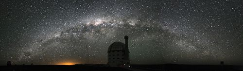
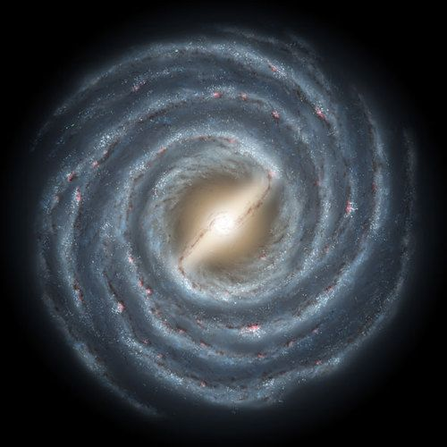
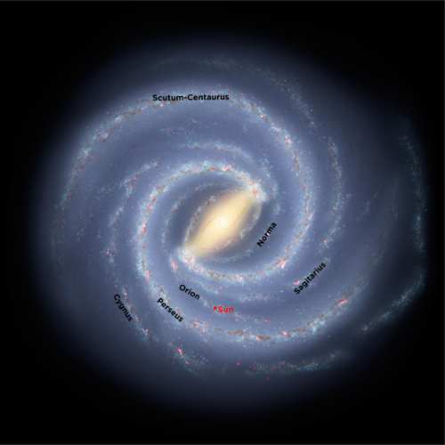
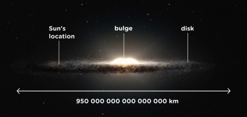
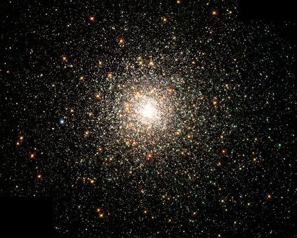

## The Milky Way Galaxy

In this section learners will discover that the Sun is one of about 200 billion stars in our home galaxy, the Milky Way. Learners will be introduced to the main features of the Milky Way Galaxy which include its central bulge, flat disk and spiral arms. Students will also learn the Sun's place within the Milky Way: we are not in the centre of our galaxy, but rather are out on the edge of our galaxy, about halfway out from the centre.

Some learners have difficulty in envisioning what they are actually looking at when they see the Milky Way in the sky at night. In fact, every individual star that we see in the sky at night is part of our Milky Way. If the Milky Way were spherical in shape, then we would not see the thin band of the Milky Way across the sky, stars would be more uniformly distributed across the whole sky. However, because the Milky Way is flat, when you look at the band of the Milky Way across the sky at night you are actually looking along the plane of the disk of the galaxy in towards the centre where there is a high density of stars. The density of stars is so high that they cannot be individually distinguished by the naked eye, and so the Milky Way appears as a white band of light across the sky.

<Callout type="note" title="Note">
- galaxy
- galaxy disk
- galaxy bulge
- spiral arm
</Callout>

At the darkest places on Earth, far away from city lights, you can see thousands of stars at night using nothing but your eyes. In fact there are many more stars in the sky which are too faint for us to see.

All of the individual stars that you can see are members of our **Milky Way Galaxy**. A galaxy is a massive collection of stars, gas and dust all held together by gravity. The Milky Way has about 200 billion stars and our Sun is just one of those stars in the Milky Way Galaxy.

From the Earth, the Milky Way looks like a bright hazy band of light across the sky, mixed in with dark dusty patches. This was called *Galaxies Kuklos* by the Greeks which means the *Milky Circle* because they thought it looked like milk spilled across the sky*.* The Romans changed the name to *Via Lactea* which means the *Milky Road* or the *Milky Way.*

<Callout type="note" title="Note">
Time lapse video of the Milky Way.
</Callout>

The Milky Way stretching across the sky viewed from Sutherland. The dark shape of the SALT telescope can be seen in the foreground with the night sky in the background (SAAO)

If you could travel outside the Milky Way and look down on it from above, the galaxy would look like a giant spiral in space as shown in the following image.

This is what the Milky Way would look like if you could see it from far away in space. Scientists only know this from many observations made from Earth. No one has actually been that far away from our galaxy to look at it. The structure is what we have inferred from other observations.

<Callout type="note" title="Note">
Discover more online and read about missions beyond our solar system.[http://solarsystem.nasa.gov/missions/profile.cfm?Sort=Target&Target=Beyond&Era=Present](http://solarsystem.nasa.gov/missions/profile.cfm?Sort=Target&Target=Beyond&Era=Present)
</Callout>

The image shows what scientists think our galaxy looks like. You can see the spiral arms of our Milky Way. These are bluish in colour and are filled with dust and gas and hot young stars. The thin dark wisps in the image are dust lanes, regions where the gas is very dusty. The central part of the galaxy is more orangey in colour than the spiral arms. This is because the stars found at the centre of the galaxy tend to be older and cooler than the young hot blue stars.

Scientists think that there are five major spiral arms in our galaxy. These are the Norma Arm, the Scutum-Crux Arm, the Sagittarius Arm, the Perseus Arm and the Cygnus Arm.

Some of the arms have alternative names, a table is included here for reference in case other names are listed in books or online.

| Common Name | Alternative Name |
| --- | --- |
| Norma Arm | 3 kiloparsec Arm |
| Scutum-Crux Arm | Centaurus Arm |
| Sagittarius Arm | Sagittarius-Carina Arm |
| Orion Arm | Local Arm |
| Perseus Arm | - |
| Cygnus Arm | Outer Arm |

Our Sun is located in a small spiral arm called the Orion (or Local) Arm which lies between the Sagittarius Arm and the Perseus Arm. Our Sun is about halfway out from the centre of the galaxy.

<Callout type="note" title="Note">
Our Solar System is orbiting around the centre of the Milky Way at thousands of kilometres per hour. But even at that speed, it still takes over 200 million years for us to make one complete orbit around the Milky Way Galaxy.
</Callout>

All the stars in this galaxy are revolving around the centre of the galaxy. Just as the Earth travels around the Sun, the Sun and our entire solar system is traveling around the centre of the Milky Way Galaxy at a speed of 250 km/s. Even though we are travelling incredibly fast, it takes the Sun about 225 million years to complete one orbit around the galaxy centre. The Milky Way is truly massive, measuring a staggering 950 000 000 000 000 000 km across!

If learners are familiar with scientific notation, then the above diameter of the Milky Way can be written as 9.5 x 1017 km.

<Callout type="note" title="Note">
If you could shrink the solar system so that the distance from the Sun to Pluto is 2.5 cm, the Milky Way would have a diameter of 2000 km (about the distance from Durban to Windhoek!)
</Callout>

<Callout type="note" title="Note">
To us the Earth seems big, but the Earth is only a very small part of the Solar System. And our Solar System is a very small part of the Milky Way Galaxy. And our galaxy is only a very small part of the whole Universe.
</Callout>

The Sun's position in the Milky Way.

If, instead of looking down on the Milky Way Galaxy, you looked at it from one side you would see that the Galaxy looks like this:

Looking at the Milky Way from the side.

The Milky Way is shaped like a giant fried egg. It is about a hundred times wider than it is thick, and it bulges in the middle. The central lump is called the **bulge** and the rest of the galaxy outside the bulge is called the **disk**.

As you know, we are inside the Milky Way Galaxy. So when you look at the thin milky-looking band stretching across the sky at night, what do you think you are actually looking at?

The thin band of light that you see is actually the stars in the Sagittarius arm as you look inwards towards the centre of the galaxy. There are so many stars densely packed together that you cannot make out individual stars with your eyes. Therefore you just see a haze of light. Above and below the plane of the disk there are very few stars.

If you look closely at the image of the Milky Way above, you can see several round fuzzy blobs dotted about above and below the disk. These are called **globular clusters** and are vast collections of hundreds of thousands of ancient stars tightly packed together by gravity. The Milky Way has an estimated 160 globular clusters. The oldest stars in the galaxy are found in these globular clusters, some are almost as old as the Universe itself.

<Callout type="note" title="Note">
Why is it dark at night?
</Callout>

A globular cluster called M80. The stars in this globular cluster are around 12.5 billion years old. Our Sun is a mere 4.5 billion years old.

# Draw the Milky Way

The aim of this activity is to reinforce the idea that the Milky Way Galaxy is a spiral galaxy with five major spiral arms in addition to some smaller arms. Learners will also be reminded that the Sun and Earth are not at the centre of the galaxy, but rather about half way out along a minor arm called the Orion Arm.

**MATERIALS:**

- black paper
- white crayon, pencil or paint
- glue - optional
- glitter or sand - optional
- newspaper for working on
- white or silver pencil/pen for labelling
- sticker - optional

**INSTRUCTIONS:**

2. Draw or paint a picture of the Milky Way. You can use the picture in the text above as a guide. The galaxy has five major spiral arms, and some smaller ones including our Orion Arm. The galaxy also has a bulge in the middle.
4. If you are going to use glitter or sand, glue along your spiral arms and in the central bulge.
6. Scatter glitter or sand over the picture, each grain represents a star in our Milky Way.
8. Tilt the picture onto the newspaper to remove any excess glitter.
10. Label each of the major arms of the Milky Way Galaxy.
12. On the Orion Arm place a sticker or mark a point halfway out from the galaxy centre. This marks the position of the Sun.

<Callout type="note" title="Note">
The sound of interstellar space.
</Callout>

How do you think astronomers know what the Milky Way looks like from the outside when they have never been outside the Milky Way? The task is similar to trying to figure out the shape of a forest from outside when you are in the middle of the forest. How would you go about this?

Learner-dependent answer. Ask learners to explain their answers. A typical response could be that we count the number of stars we see in each direction.

Astronomers look at the sky in all directions and count the number of stars that they see, they also measure the distance to each of the stars so that they can build up a three dimensional map of the galaxy. One of the difficulties that astronomers have in doing this is seeing through all the dust in the galaxy which dims the optical light coming from the stars.

<Callout type="note" title="Note">
Video showing us zooming out from the Earth to outside our galaxy.[http://science.nasa.gov/media/medialibrary/2010/03/31/earth2localgroup_sm.mov](http://science.nasa.gov/media/medialibrary/2010/03/31/earth2localgroup_sm.mov)
</Callout>

# Make the Milky Way

In this activity learners will make a model of the Milky Way. They must come up with the best materials they can think of and obtain for their models. For example, they can use cardboard, cotton wool balls and glitter. This can be done as a group model, where learners are given the task a couple days before the lesson and they must collect the materials, or else you can supply a selection of materials in class which they can then use to build the model. Encourage learners to be creative when thinking about the materials to use to represent the different components.

The aim of this activity is to give learners a three dimensional view of the Milky Way, including the structure of the central bulge and the disk containing the spiral arms. The glitter is used to represent the distribution of stars and the colours are used to demonstrate how old and young stars are distributed in the galaxy. The life cycle of stars in not covered until Grade 9. Therefore, although you may want to mention that the stellar populations in the bulge and the disk of our galaxy are different, it is not essential to do so.

**MATERIALS:**

- thick piece of black cardboard at least 30 cm across
- other materials for your model, either collected by you or supplied by your teacher

Examples of other materials to supply are:

- a bag of cotton balls or pillow stuffing
- glue
- string
- pencil
- red, blue, gold and silver glitter
- star sticker

<Callout type="note" title="Note">
We will learn more about the life cycle of stars in Gr 9. Younger stars are hotter and bright white or blue in colour, while older stars are cooler and more yellow and red in colour.
</Callout>

**INSTRUCTIONS:**

2. You need to build a 3 dimensional model of the Milky Way Galaxy. You will either need to collect the most appropriate materials for your model beforehand, or else your teacher will supply you with a selection of materials to use in class.
4. Cut out a circle of radius 15 cm from the black card and use this to build your 3D model.
6. You must show the central bulge, the spiral arms and the different coloured stars.
8. Mark the position of our Sun on your model.
10. Using your model, view it from different angles and compare the view you have with the images of the Milky Way in this chapter.

Learners must come up with their own model designs. An example design is included here if you would prefer to make one which you then use to demonstrate to learners, instead of them making their own:

2. Build a dome of cotton balls in the centre of one side of the cardboard. Use glue to keep the cotton balls in place. The dome should be about 8 cm across and 4cm high.
4. Repeat on other side of the board. The cotton ball dome represents the bulge of our galaxy.
6. Pull the outer cotton balls into six spirals around the cotton ball dome. These represent the five major spiral arms found in the disk of our galaxy, in addition to the minor spiral arm that our Sun is found in.
8. Dribble glue on the spiral arms and sprinkle blue and silver glitter on the glue. These represent hot newly forming stars.
10. Dribble glue all over the cotton wool dome ball in the middle and sprinkle this glue with gold and red glitter to represent cooler, older stars.
12. Mark a position 8 cm from the centre inside one of the spiral arms.
14. Stick the star sticker on the spiral arm at the marked position. This marks the position of our Sun.
16. Make a hole in the centre of the model and thread it with a string so that it can be hung up.

**QUESTIONS:**

**Problem:**
What are the two main parts that make up our Milky Way Galaxy?

**Solution:**
The disk and the bulge.

**Problem:**
Where are the spiral arms located; in the disk or the bulge of our galaxy?

**Solution:**
In the disk.

**Problem:**
Is our Sun found in the central bulge or in a spiral arm in the disk?

**Solution:**
Our Sun is located in a spiral arm.

**Problem:**
How far from the centre of the galaxy is our Sun located?

**Solution:**
Just over half way out from the centre.
