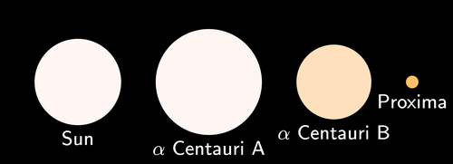

## Our nearest star

In this brief section learners will be introduced to the large distances found between stars in preparation for the following section on light hours, minutes and seconds.

<Callout type="note" title="Note">
- Proxima Centauri
- Alpha Centauri
- constellation
</Callout>

The Sun is our closest star, and is *only* 150 million kilometres from Earth. When you look up at the sky at night, if you are lucky enough to be far from the glare of city lights, you can see thousands of stars. For those of you in a city, perhaps you can see hundreds of stars, depending on the amount of light pollution from street lights and other light sources. As you know, there are actually billions of stars in our galaxy but most of them are too faint to see from Earth.

<Callout type="note" title="Note">
A constellation is a group of stars that, when viewed from Earth, form a pattern in the sky.
</Callout>

Of the brighter stars, one famous **constellation** that is visible, even from big cities in South Africa, is the Southern Cross or Crux. The two bright stars at the bottom left pointing towards the cross are called the pointers.

<Callout type="note" title="Note">
You can find south using the Southern Cross Constellation. Just extend the long axis of the cross 4 times and then go straight down to the horizon to find south.
</Callout>

The Pointers (circled) and the Southern Cross.

The brightest of the Pointers looks slightly orange if you look closely. This star is called **Alpha Centauri** and is our closest easily visible star after the Sun. Alpha Centauri is actually part of a triple star system which is where three stars are in orbit around each other. The two main stars of the system are called Alpha Centauri A and Alpha Centauri B. They orbit close together, on average about eleven times the Earth-Sun distance from each other.

A smaller, fainter star, called **Proxima Centauri**, orbits much farther out. If you were to look at Alpha Centauri through a small telescope, instead of one star you would be able to make out the two separate stars Alpha Centauri A and B next to each other. Proxima Centauri is much fainter and further away from the other two so you would not see this one with the other two.

A comparison of the sizes of the Alpha Centauri star system and the Sun.

Proxima Centauri, the closest star to our own Sun, is about 40 trillion km away from the Earth. Alpha Centauri A and B are slightly farther away, at 42 trillion km away from us. Our closest star is 694 times farther away than Pluto is. These numbers are astronomically large! As the numbers are so large, astronomers do not use kilometres to measure the distances to stars, but use larger units based on the speed of light, which you will discover in the next section of this chapter.

Do you know how much a trillion or a billion is? Have a look at the following table

| In words | In number format |
| --- | --- |
| one thousand | 1 000 |
| one million | 1 000 000 |
| one billion | 1 000 000 000 |
| one trillion | 1 000 000 000 |

<Callout type="note" title="Note">
Proxima Centauri was discovered in 1915 by the Scottish astronomer Robert Innes. He was the director of what was then the Union Observatory in South Africa.
</Callout>

<Callout type="note" title="Note">
Astronomers have recently discovered a planet similar in size to the Earth orbiting around Alpha Centauri B, but we think it is too close to the star to have life on it.
</Callout>

The following is an **optional, extension activity** that you can do on scientific notation with your learners. Scientific notation is only covered in Gr 9 Mathematics, however. many of the numbers used in this chapter are very long, and so can be written in scientific notation. Also, if you do some of the subsequent activities doing calculations with a calculator, the answers will be given in scientific notation. It is therefore useful for learners to know what this is. You can use the following activity to explain scientific notation to learners and write some of the examples given in the tables on the board as examples.

**Activity: Scientific notation**

In science one often needs to work with very large or very small numbers. For example, we spoke about the distance from Earth to our next closest star after the Sun as being 40 trillion km. How much is a trillion?

Look at the following table:

| In words | In number format | In scientific notation |
| --- | --- | --- |
| one thousand | 1 000 | 1,0 x 103 |
| one million | 1 000 000 | 1,0 x 106 |
| one billion | 1 000 000 000 | 1,0 x 109 |
| one trillion | 1 000 000 000 000 | 1,0 x 1012 |

Therefore, the distance from Earth to Proxima Centauri is 40 000 000 000 000 km. This is a very large number to work with.

Very large and very small numbers can be written more easily (and more compactly) in **scientific notation**, in the general form:

N x 10n

N is a decimal number between 0 and 10 that is rounded off to a few decimal places. n is known as the exponent and is an integer.

If n is bigger than 0 it represents how many times the decimal place in N should be moved to the **right**. If n is smaller than 0, then it represents how many times the decimal place in N should be moved to the **left**.

For example, 3,24 x 103 represents 3240 (the decimal moved three places to the right) and 3,24 x 10-3 represents 0,00324 (the decimal moved three places to the left).

If we wanted to write the distance from the Earth to Proxima Centauri in scientific notation, we need to count how many times the decimal comma must move so that N is a number between 0 and 10. It must move 13 times. Therefore 40 000 000 000 000 km can be written as 4,0 x 1013 km.

Look at the following examples.

| Standard number | Scientific notation |
| --- | --- |
| 200 | 2 x 102 |
| 1 500 | 1,5 x 103 |
| 67 890 | 6,789 x 104 |
| 48 000 210 | 4,8 x 107 |
| 0,02 | 2 x 10-2 |
