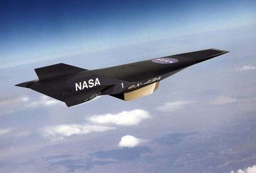
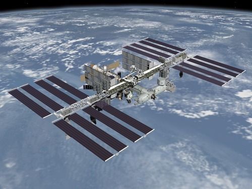
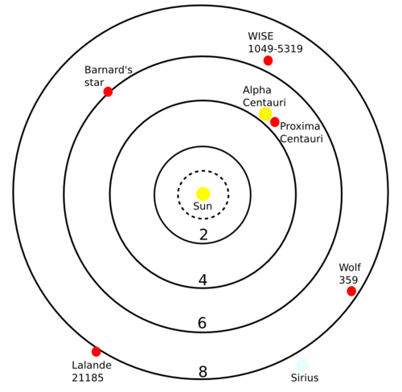

## Light years, light hours and light minutes

In this section, learners will be introduced to the concept of light years, light hours and light minutes. These units of *distance* are used for interstellar (between stars) and interplanetary (between planets) distances because the distances involved are huge and familiar units like metres and kilometres are just too small.

Because of the references to time in each of these distance units, learners can often mistake these units as units of time rather than units of distance. It is important to address this misconception. For example, a light hour is the distance that light travels in one hour of time. Although time is involved the final measurement is actually a distance.

A useful activity to introduce the topic is to ask learners how far they *estimate* they could walk, run and cycle in one hour. Although they have to use time in their estimation they should understand that they are estimating a *distance.* This example also includes the concept of speed. Learners should understand that if they move faster they will travel further in a given hour. Starting off by using activities that they are familiar with should prove useful when then going on to deal with the rather abstract concept of the speed of light.

This section is fairly mathematical and learners will need a calculator to complete the activities. It is useful (although not essential) if learners understand scientific notation. Learners need to understand what a million, billion and trillion correspond to and so if in doubt it might prove useful to remind learners of the powers of ten involved for millions, billions and trillions. Formulae for calculations have been provided where necessary, and it is expected that most learners will be familiar with the formula *speed = distance / time.* If learners are unfamiliar with this concept it would be a useful exercise to explain this before starting on the exercises in this section.

<Callout type="note" title="Note">
- light minute
- light hour
- light year
</Callout>

Our solar system is a pretty big place. Our nearest neighbour, the Moon, is on average 384 400 kilometres away, and the closest to us that our nearest planet Venus gets is about 42 million kilometres. The Sun is about 150 million kilometres away and the closest that Pluto can ever get to us is 4.3 billion kilometres. These large numbers are impractical to use and so we rather use much larger distance units based on the speed of light. This makes the numbers smaller and easier to deal with.

This is just like using metres instead of centimetres to make the numbers smaller when you measure a distance. For example, if you are telling a friend how far it is from your house to school, you would say it is 7.5 km, and not 7 500 000 cm. Let's begin by comparing the speed of light with the speed of some other things that move very fast.

<Callout type="note" title="Note">
Scale of the Universe.
</Callout>

# Travelling fast

A cheetah, the fastest land mammal, can reach speeds of 120 km/h, as fast as cars on the highway.

A Peregrine Falcon, the fastest animal, can fly as fast as 389 km/h.

Japan's high speed train the JR-Maglev MLX01 has reached 581 km/h.

NASA's scramjet the X-43 flies at 7000 km/h.

The international space station (ISS) orbits the Earth at a speed of 27 744 km/h.

What about light? Light travels at about 1080 million km/h, or 299 792 458 m/s.

<Callout type="note" title="Note">
How to break the speed of light.
</Callout>

**INSTRUCTIONS:**

2. Imagine you are going on a trip from Cape Town to Durban, which is a distance of 1753 km.
4. Calculate how long it would take you to complete the trip travelling at the speeds of the animals and modes of transport in the examples above.
6. Fill in your answers in the table below.

Remember the formula *time = distance / speed*

| Mode of transport | Speed (km/h) | Distance between Cape Town and Durban (km) | Time taken for the journey |
| --- | --- | --- | --- |
| cheetah | 120 | 1753 | 14.6 hours |
| peregrine falcon |  | 1753 | ________ hours |
| high speed train |  | 1753 | ________ hours |
| NASA's scramjet |  | 1753 | ________ minutes |
| International space station |  | 1753 | ________ seconds |
| light |  | 1753 | ________ seconds |

| Mode of transport | Speed (km/h) | Distance between Cape Town and Durban (km) | Time taken for the journey |
| --- | --- | --- | --- |
| cheetah | 120 | 1753 | 14.6 hours |
| peregrine falcon | 389 | 1753 | 4.5 hours |
| high speed train | 581 | 1753 | 3.0 hours |
| NASA's scramjet | 7000 | 1753 | 15 minutes |
| International space station | 27 744 | 1753 | 3.8 minutes |
| light | 1079 252 850 | 1753 | 0.006 seconds |

Light is amazingly fast. Look at the examples below.

| In one second light can travel… | Light takes… |
| --- | --- |
| between Cape Town and Johannesburg 214 times. | 0.0000003 seconds to travel 100 m. |
| between Cape Town and London, England, 31 times. | 1.3 seconds to travel from the Earth to the Moon. |
| around the Earth 7.5 times. | 8 minutes to travel from the Sun to the Earth. |

<Callout type="note" title="Note">
How far is a second?
</Callout>

For distances within the solar system, astronomers use units called **light hours** and **light minutes**.

A light hour is the **distance** that light travels in one hour. Despite its name, a light hour is not a unit of time, it is a **unit of distance**.

What do you think a light minute corresponds to?

It is the distance that light travels in one minute.

Which do you think is a smaller distance, a light hour or a light minute, and why?

A light minute is smaller because the light has less time to travel in a minute than an hour. So a light minute must be shorter because this represents the distance that light travels in a minute.

Astronomers use units called **light years** to measure the distances between stars and galaxies. One light year is almost 10 trillion kilometres. As you can see, a light year is very, very far.

Light years, light hours and light minutes measure distances. They also tell us something else very interesting. If you measure the distance to a light source in light travel time, you can work out how long light emitted from the distant source takes to reach you. Light that is emitted from an object one light year away from you, takes one year to reach your eyes. Similarly, light that is emitted from an object one light hour away, takes one hour to reach your eyes. How long do you think light emitted from one light minute away takes to reach your eyes?

One minute.

<Callout type="note" title="Note">
How far is a light year?
</Callout>

This may sound very strange to you because when you switch on a lamp in your home you see the light straight away. You do not have to wait for the light from the lamp to reach you. You do not notice that it actually takes some time for the light from the lamp to reach your eyes because light travels extremely fast. Light travels so fast, that if you were standing a metre away from the lamp it would only take only three billionths of a second for the light from the lamp to reach your eyes. It is therefore no surprise that you don't notice the delay.

<Callout type="note" title="Note">
Scale of the Universe interactive animation.[http://scaleofuniverse.com/](http://scaleofuniverse.com/)
</Callout>

<Callout type="note" title="Note">
The speed of light is special, nothing can move faster than the speed of light, it is like a cosmic speed limit.
</Callout>

# Scale of the solar system

Question 7 in the activity is an advanced question for able learners.

**INSTRUCTIONS:**

2. The table below shows the distance that each planet lies from the Sun in kilometres (km) and then in light hours or light minutes.
4. Answer the questions.

Distances of each planet from the Sun.

| Planet | Distance from the Sun (million km) | Distance from the Sun in light hours or minutes |
| --- | --- | --- |
| Mercury | 57.9 | 3.2 light minutes |
| Venus | 108.2 | 6.0 light minutes |
| Earth | 149.6 | 8.3 light minutes |
| Mars | 227.9 | 12.7 light minutes |
| Jupiter | 778.6 | 43.3 light minutes |
| Saturn | 1433.5 | 1.3 light hours |
| Uranus | 2872.5 | 2.7 light hours |
| Neptune | 4495.1 | 4.2 light hours |

**QUESTIONS:**

**Problem:**
How far away from the Sun is Earth?

**Solution:**
8.32 light minutes.

**Problem:**
How long does light take to travel from the Sun to the Earth?

**Solution:**
8.32 minutes.

**Problem:**
What does the answer to (2) imply about our view of the Sun?

**Solution:**
We see the Sun as it was 8.32 minutes ago.

**Problem:**
How many times further away from the Sun than the Earth is Neptune?

**Solution:**
30 times further. This is calculated by dividing the distance from the Sun to Neptune by the distance from the Sun to Earth: 4495/150 = 30.

**Problem:**
How far away from the Sun is Neptune in light hours?

**Solution:**
4.17 light hours.

**Problem:**
How long does light from the Sun take to reach Neptune?

**Solution:**
4.17 hours.

**Problem:**
Imagine you have a cousin living on Neptune. You and your cousin both decide to look at the Sun, each of you using a telescope with a special solar filter so as not to damage your eyes. As you are watching the Sun you suddenly notice a big blob of gas thrown off in a massive solar flare. You cousin says she cannot see it. Why is that?

**Solution:**
If you see the flare happen from Earth, then the flare happened 8 minutes ago. The light from the Sun showing the flare takes 4.2 hours to reach Neptune (about 4 hours 24 minutes), so your cousin will only see the flare in 4 hours 16 minutes time.

As you can see, the solar system is very large. The orbit of Neptune is over 4 light hours from the Sun and the Kuiper Belt and Oort Cloud extend out even further than this.

The distance to the next closest star, Proxima Centauri, is 40 trillion km. This corresponds to 4.24 light years. This means that light from the star takes just over four years to reach Earth. Let's investigate the distances to some of our closest stars.

# Our closest stars

In this activity learners will get a feel for how "close" the nearest stars are to the Sun. The idea of this activity is to familarise learners with the idea that stellar distances are generally measured in light years (rather than light minutes or hours which apply to solar system objects).

**INSTRUCTIONS:**

2. Look at the table showing our closest stars and the star map.
4. Answer the questions below.

| Star | Distance (light years) |
| --- | --- |
| Proxima Centauri | 4.24 |
| Alpha Centauri | 4.37 |
| Barnard's Star | 5.96 |
| WISE 1049-5319 | 6.52 |
| Wolf 359 | 7.78 |
| Lalande 21185 | 8.29 |
| Sirius | 8.58 |

The following map shows the Sun in the centre with the locations of our closest stars. Each solid ring represents a distance of 2, 4, 6 and 8 light years from the Sun. The dotted circle represents the Oort Cloud.

<Callout type="note" title="Note">
The star map is shown in two dimensions, on a flat plane. Remember that the stars are located in 3 dimensions in space.
</Callout>

<Callout type="note" title="Note">
Always remember to write the units after your answer.
</Callout>

**QUESTIONS:**

**Problem:**
Which star is our closest neighbour, excluding the Sun?

**Solution:**
Proxima Centauri.

**Problem:**
How far is Sirius?

**Solution:**
Sirius is 8.58 light years away.

**Problem:**
How long does light from Barnard's Star take to reach us?

**Solution:**
Light takes 5.96 years to reach us from Barnard's star.

**Problem:**
Explain in your own words what the statement "Sirius is 8.58 light years away from Earth" means.

**Solution:**
It means that the star is at the distance that light can travel in 8.58 years. It means that light takes 8.58 years to reach us on Earth from Sirius.

<Callout type="note" title="Note">
The Milky Way is so large that light takes 100 000 years to cross from one side to the other side.
</Callout>

Our closest stars are less than ten light years away, however most stars in our galaxy are much farther away. The distances to stars are generally measured in tens, hundreds or even thousands of light years and the distances between galaxies are truly enormous as you will discover in the next section.
