## What is beyond the Milky Way Galaxy?

In this section learners will find out what lies beyond our own galaxy. They will learn that there are billions of other galaxies in our Universe of all shapes and sizes. They will learn about the different types of galaxies, i.e. ellipticals, spirals, barred spirals, lenticular and irregular types. Learners **do not** have to know the actual names of the different shapes (this is included for interest), but they must know the shape of the Milky Way Galaxy and understand that other galaxies have different shapes. The will also look at how galaxies are arranged in the Universe: into groups and clusters of galaxies, and finally they will look at the Universe on its grandest scale finding out how matter is arranged into voids and filaments.

<Callout type="note" title="Note">
- galaxy
- galaxy group
- galaxy cluster
- filament
- void
- Universe
</Callout>

Our galaxy, the Milky Way, is only one out of a total of about 100 to 200 billion galaxies that astronomers estimate to be in the **Universe**. That's more than 10 times the total number of people on Earth.

As well as stars, galaxies contain vast amounts of gas and dust. Galaxies come in a variety of shapes and sizes. The Milky Way is an average-sized spiral galaxy: it is 100 000 light years across and contains around 200 billion stars. Small galaxies may contain only a few million stars, while large galaxies can have several trillion stars.

<Callout type="note" title="Note">
The distances between galaxies are even larger than the sizes of galaxies and are measured in millions or even billions of light years.
</Callout>

Our closest galaxy neighbour is called the Andromeda Galaxy. Andromeda is 2.5 *million* light years away from the Milky Way. If you wanted to travel to Andromeda and could travel as fast as light, it would still take you 2.5 million years to get there.

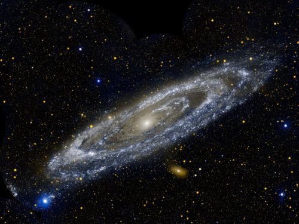

Our closest neighbouring galaxy, Andromeda. Light from the galaxy takes 2.5 million years to reach Earth and so the light that hits your eyes now from that galaxy was emitted before there were humans on Earth.

<Callout type="note" title="Note">
The Milky Way and Andromeda galaxies are moving towards each other on a collision course and astronomers estimate that the two galaxies will collide in around 4 billion years time. No need to worry just yet!
</Callout>

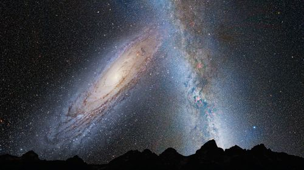

This illustration shows a stage in the predicted collision between our Milky Way Galaxy and the neighboring Andromeda Galaxy, as it will unfold over the next several billion years. This image shows how we think Earth's night sky will look like in 3.75 billion years time.

<Callout type="note" title="Note">
What is the Universe?
</Callout>

<Callout type="note" title="Note">
How big is the Universe?
</Callout>

There are five main types of galaxies. You do not need to know these names. This is included for your interest.

- spiral
- barred spiral
- elliptical
- lenticular
- irregular

Extra information on the different shapes of galaxies:

- Spiral galaxies have a central bulge and a flat disk with spiral arms.
- Some spiral galaxies have arms that do not start at the centre of the galaxy but start at the end of a bright straight *bar* that goes across the centre of the galaxy. These are called barred spiral galaxies.
- Elliptical galaxies look smooth and are shaped like giant rugby balls with no spiral arms. Some can be round and some can be very elongated. They contain old stars and have very little gas and dust.
- A lenticular galaxy is in between a spiral galaxy and an elliptical galaxy. They are disk galaxies (like spiral galaxies) but do not have defined arms as they have lost most of their dust and gas. As a result, there is little star formation happening and they consist of mostly old stars (like elliptical galaxies.)
- Irregular galaxies do not look like spirals or elliptical galaxies. Some (but not all) irregular galaxies are actually two or more galaxies in the process of colliding.

<Callout type="note" title="Note">
The largest known galaxy in the Universe.
</Callout>

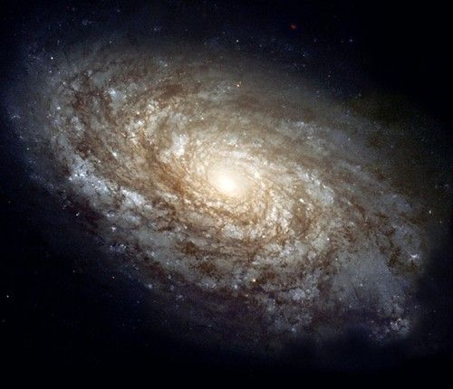

Spiral galaxy named NGC 4414.

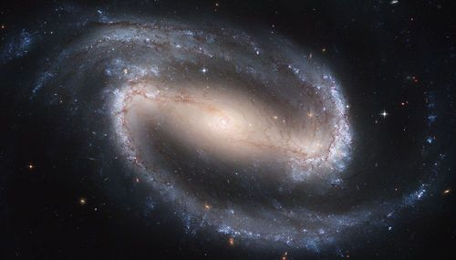

Barred spiral galaxy named NGC 1300.

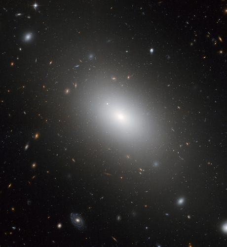

Elliptical galaxy NGC 1132.

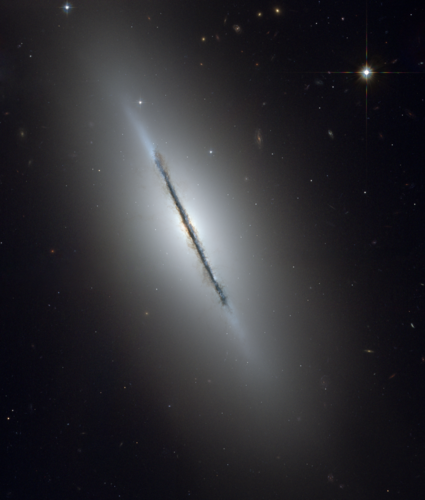

A lenticular galaxy, called NGC 5866.

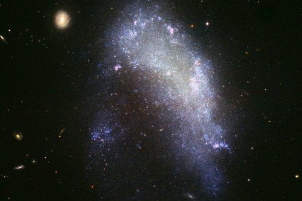

Irregular galaxy named NGC 1427A.

Let's do an activity to explore the different types of galaxies we see.

<Callout type="note" title="Note">
Galaxy Zoo - take part in some real astronomical research by classifying the shapes of different galaxies in this citizen science project.[http://www.galaxyzoo.org/](http://www.galaxyzoo.org/)
</Callout>

There is a really relevant link provided in the Visit box for the citizen science project, **Galaxy Zoo**. This is a really great way for you and learners to become actively involved in some real science research related to what you are doing in class. If you have internet access and a projector in your class, a suggestion is to bring this site up and go through some of the galaxies with your learners and classify them according to their shapes. Find out more about incorporating real science into your classroom with Zooniverse citizen science projects at the ZooTeach website: [http://www.zooteach.org/.](http://www.zooteach.org/.). Citizen science offers you a free, easily accessible and inspiring opportunity to bring real science into the classroom.

ZooTeach is a website where teachers and educators can share high quality lesson plans and resources that complement the Zooniverse citizen science projects.

<Callout type="note" title="Note">
Something fun - have a look at this picture of a cheetah created using thousands of images of galaxies from Galaxy Zoo.[http://daily.zooniverse.org/2013/10/16/a-cheetah-made-from-galaxies/](http://daily.zooniverse.org/2013/10/16/a-cheetah-made-from-galaxies/)
</Callout>

# Comparing galaxies

This is an optional, extension activity. In this activity learners will describe and compare the appearance of six different galaxies. They will also rank the galaxies in terms of increasing distance from Earth.

**MATERIALS:**

- images of the galaxies to be compared

**INSTRUCTIONS:**

2. Look at the images of the of six galaxies used in this activity.
4. Using the information in this chapter, write down in the table what type of galaxy our Milky Way Galaxy is.
6. Write down in the table below what type of galaxy (spiral, barred spiral, elliptical or irregular) you think each galaxy is.

| Galaxy Name | Galaxy type |
| --- | --- |
| The Milky Way Galaxy. |  |
| Galaxy M 89. The galaxy is 60 million light years away. |  |
| Galaxy NGC 4622. The galaxy is 111 million light years away. |  |
| The Large Magellanic Cloud galaxy. This satellite galaxy of our own Milky Way is only 163 000 light years away. |  |
| The Spindle Galaxy, 44 million light years away. |  |

| Galaxy Name | Galaxy type and reason |
| --- | --- |
| Milky Way Galaxy. | Barred spiral galaxy (because it has spiral arms with a bright, central bar) |
| Galaxy M 89, 60 million light years away. | Elliptical galaxy (because it is round and smooth with no spiral arms) |
| Galaxy NGC 4622, 111 million light years away. | Spiral galaxy (because it has spiral arms) |
| The Large Magellanic Cloud galaxy. This satellite galaxy of our own Milky Way is only 163 000 light years away. | Irregular galaxy (it does not have spiral arms and is not a smooth oval shape like elliptical galaxies. It looks like an irregular shape) |
| The Spindle Galaxy, 44 million light years away. | Lenticular galaxy (because disk shaped, with a central bulge, but no spiral arms) |

**QUESTION:**

List the galaxies in the table above in increasing order of distance from our Milky Way Galaxy.

The LMC, the Spindle Galaxy, M 89, NGC 4622.

Have a look at the following diagram which shows the location of Earth in the Universe. **You do not need to know this classification**; this is included for your interest.

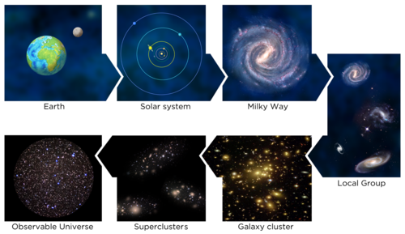

- Most galaxies are found gathered together in gigantic galaxy neighbourhoods, called **galaxy groups**. Our Milky Way is found in a group of galaxies called **The Local Group.**
- **Galaxy clusters** are even larger, spanning tens of millions of light years, and can contain hundreds or even thousands of galaxies.
- Many clusters of galaxies come together to form **superclusters** of galaxies. Our own local group is part of the Virgo supercluster.
- Gravity holds the galaxies in groups, clusters and superclusters together.

<Callout type="note" title="Note">
What is dark matter?
</Callout>

<Callout type="note" title="Note">
The Hubble Extreme Deep Field is the most distant picture of the Universe ever taken. Astronomers used the Hubble Telescope to take an image of a small patch of sky. Around 5500 galaxies of all shapes, sizes and colours were discovered in the image.
</Callout>

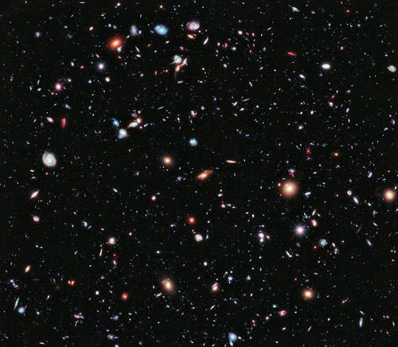

Galaxies in the Hubble Extreme Deep Field. Every smudge in the image is a distant galaxy.

<Callout type="note" title="Note">
How do we know how many galaxies there are in the Universe?
</Callout>

**Extension content and activity**

Galaxy clusters are beautiful yet peculiar objects. They seem to be full of a mysterious unseen type of matter which has not yet been identified. From its gravitational effects on the gas and galaxies in the cluster, astronomers estimate that this strange matter could be about five times more massive than all the galaxies and hot gas in a cluster combined. Astronomers have no idea what this mysterious matter is and call it **dark matter,** because they cannot see it. It turns out that this strange matter is not only found in clusters of galaxies, but is spread throughout space.

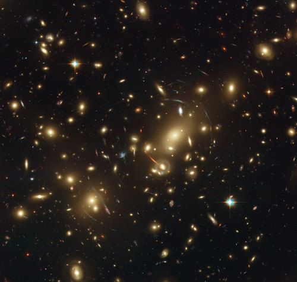

The galaxy cluster called Abell 2218. Each point of light is a galaxy.

If you look closely at the image of galaxy cluster Abell 2218, in addition to the galaxies that make up the cluster you can see thin arcs. These are images of distant galaxies behind the cluster that are distorted by matter in the cluster. The cluster of galaxies acts like a giant lens, bending and distorting the light coming from the more distant galaxies. The distant galaxies are not actually this funny shape, they are usually elliptical or spiral shaped. They just appear this way because of the lensing.

Matter bends light, just like a lens does, although the effect is much weaker, otherwise our torches would have bent light beams. When matter acts to bend light astronomers refer to the matter as a gravitational lens. Clusters of galaxies make excellent gravitational lenses because they are so massive. Most of the lensing however does not come from the galaxies or the hot gas in the cluster, but from the unseen dark matter within the cluster.

**Activity: Wine glass gravitational lens**

*
**Note**: This activity can be done as an extension if you decide to discuss the above content on dark matter with learners. However, this is beyond the scope of CAPS and has only been included as an optional extension. This activity can be done individually, but if there are not enough wine glasses for the entire class then learners can work in small groups and take it in turns within their group to complete this activity. It can sometimes be a bit difficult to see the rings and arcs clearly. To aid this, use a bright red pen rather than a black pen, and it may help if learners close one eye and just use one eye to observe the arcs and rings produced in this activity.
                *

In this activity you will investigate how a wine glass acts like a lens, bending light. Dark matter in the Universe also acts like a lens, bending the light from distant galaxies making their images distorted into rings or arcs. While the wine glass bends the light due to refraction, dark matter bends the light because it has mass, and is called a gravitational lens.

**MATERIALS:**

- wine glass
- paper (graph paper if possible)
- red pen/marker
- water

**INSTRUCTIONS:**

2. Make a large dot on the graph paper using the red marker.
4. Place the wine glass on the graph paper and look directly down at the paper through the wine glass. Observe how it distorts the grid of the graph paper.
6. Centre the wine glass over the dot and look directly down at the paper through the wine glass. Make a note of your observations below.
8. Move the wine glass from side to side and up and down along the paper slightly and note what you observe.
10. Repeat steps 3 to 4, but this time raise the glass above the paper by about 3 cm. Note what you observe.
12. Add some water to the wine glass and repeat step 5. Note what you observe.

*
**Note:** If the dot is centred below the wine glass, learners should view a ring. If it is not centred, they should see arcs.*

**Ask learners the following questions:**

2. When the wine glass was centred above the dot what did you observe?
   *Red ring*
4. When the wine glass was not centred what did you observe?
   *Red arcs*
6. If you moved the wine glass left and right, what happened?
   *The arcs move. If you move the glass to the left, the arc is on the right hand side and if you move the glass to the right, the arc appears on the left hand side.*
8. Given your observations here, what can you say about the orientation of the galaxy cluster Abell 2218, shown in the last image? Is it in line with the distant galaxies or offset slightly? (Hint: do you see arcs or a ring?)
   *In the picture above you can see faint arcs in the image. This means that the gravitational lens and the background galaxies cannot be lined up perfectly, otherwise you would see a ring.*

### The Observable Universe

<Callout type="note" title="Note">
How big is the Universe?
</Callout>

Learners do not need to know the structure of the Universe in terms of filaments and voids. This is included as enrichment content. Learners do need to know what we mean by the observable Universe though.

There is an error in the CAPS document which incorrectly states that the size of the observable Universe is 28 billion light years. In fact the size of the observable Universe is about 93 billion light years which corresponds to 28 billion parsecs - a parsec is a unit of distance used in astronomy and is equal to about 3.1x1013 km or about 3.3 light years.

Note that the observable Universe, is the region that is visible from Earth it is not the whole of the Universe. The size of the whole Universe is unknown and it may be infinite in size. "Infinite in size" is a difficult concept for most learners to grasp and so it has been deliberately omitted from this text. You should use your own judgement as to whether it is suitable to consider elaborating upon the size of the unobservable Universe within your class.

<Callout type="note" title="Note">
On the largest scales the Universe resembles a giant bath sponge. The galaxy clusters are arranged in thin walls called **filaments**. Between the filaments are huge gaps which contain very few galaxies and so are called **voids**.
</Callout>

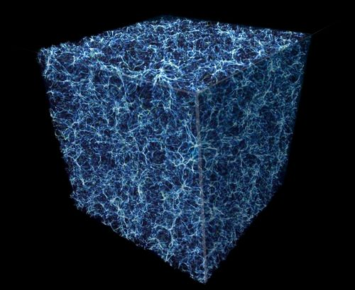

This computer generated graphic represents a slice of the sponge-like structure of the Universe. All the galaxies lie along thin walls called filaments. The darker areas show the voids where there are no galaxies.

Astronomers estimate that the age of the Universe is 13.7 billion years old. This might make you imagine that you can see objects from as far as 13.7 billion light years away in all directions. If you were to draw a sphere around the Earth, with a radius of 13.7 billion light years, with the Earth placed at the centre, the surface of the sphere would represent the limit of how far light could travel to Earth in 13.7 billion years. The surface would represent the edge of the *observable Universe as seen from Earth*. You might therefore assume that the diameter of the **observable Universe** is 27.4 billion light years (2 times 13.7).

<Callout type="note" title="Note">
The size of the Universe.
</Callout>

However, you would actually be wrong. Astronomers estimate the size of the observable Universe to be 93 billion light years in diameter, which is much, much larger. The reason that the size is much larger than expected is because the Universe is expanding and galaxies are moving further and further away from the Earth as the space between them expands. So we are able to see galaxies that are now very far away because when they emitted their light they were closer to Earth. The size of the whole Universe, which includes regions too far from Earth for us to see at this time, is unknown.

<Callout type="note" title="Note">
Do we expand with the Universe?
</Callout>

Following is a demonstration that you can perform to show learners what is meant by the expanding Universe.

**Activity: The expanding Universe**

*
**Note:** This is a demonstration to help learners visualize how the space between galaxies is expanding. This is a simple 2D analogy of the true 3D situation. In this demonstration the surface of the balloon is a two dimensional representation of space and circles on the surface of the balloon represent galaxies in space. As the balloon is blown up, representing the expanding Universe, the distances between neighbouring galaxies increase which is exactly what is observed in the expanding Universe.
                  *

**MATERIALS:**

- one balloon
- small circles of paper
- glue

**INSTRUCTIONS:**

2. Cut out small circles of paper and stick them onto the balloon. Each circle represents a galaxy in the Universe.
4. Blow up the balloon halfway. Note what happens to the distance between the paper circles.
6. Blow up the balloon fully. Note what happens to the distance between the paper circles dots.

**Ask learners the following questions:**

2. What happened to the distance between the paper circles as you inflated the balloon?
   *As the balloon was inflated the distance between the dots increased.*
4. What do you think would happen if you could inflate the balloon to an even larger size? *The distance between the dots would increase even further.*
6. What do the paper circles represent and what does the inflating balloon represent?

*The dots represent galaxies and the inflating balloon represents the expansion of the space between them. The balloon represents the expansion of the Universe.*

<Callout type="note" title="Note">
Read interesting articles on the latest developments in astronomical research on**Space Scoop**, an astronomy news service. [http://www.unawe.org/kids/](http://www.unawe.org/kids/)
</Callout>

<Callout type="note" title="Note">
- A galaxy is a collection of millions or billions of stars, together with gas and dust, held together by gravity.
- Galaxies come in all shapes and sizes.
- Our home galaxy, the Milky Way Galaxy, is a spiral galaxy containing around 200 billion stars. Our Sun is just one of those stars.
- After the Sun, our nearest star is Alpha Centauri, the brighter of the two pointer stars in the Southern Cross Constellation
- Light minutes, light hours and light years are used to measure distances in space because the distances are so immense.
  - A light minute is the distance that light can travel in one minute.
  - A light hour is the distance that light can travel in one hour.
  - A light year is the distance that light can travel in one year.
- Beyond the Milky Way Galaxy, are many more galaxies.
- Astronomers estimate the size of the observable Universe to be 93 billion light years in diameter.
</Callout>

**Concept Map**

Remember that you can also add your own notes to the concept maps to expand and personalise them.

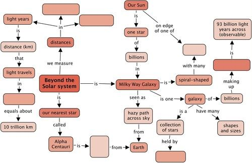

Teacher's version

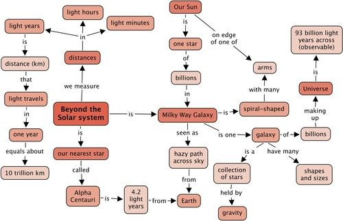

**Problem:**
What is the name of our second closest star? How far away is it? [2 marks]

**Solution:**
Proxima Centauri. 4.24 light years away.

**Problem:**
What is the name of our second closest easily visible star? Is it really a single star? [2 marks]

**Solution:**
Alpha Centauri. Alpha Centauri is actually a multiple star system containing the stars Alpha Centauri A and B closely orbiting each other. To the naked eye these two stars look like a single star. Proxima Centauri is also thought to be a member of this star system but it is farther away from the other two stars.

**Problem:**
What is the definition of a light year? [2 marks]

**Solution:**
A light year is the distance that light travels in one year.

**Problem:**
What is a galaxy? [3 marks]

**Solution:**
A galaxy is a massive collection of stars, dust and gas held together by gravity. A typical galaxy contains hundreds of billions of stars.

**Problem:**
Where is the Sun located within the Milky Way? [2 marks]

**Solution:**
It is located in the Orion spiral arm halfway out from the centre of the galaxy.

**Problem:**
How many stars are in our Milky Way Galaxy? [1 mark]

**Solution:**
200 billion.

**Problem:**
Name the 4 main types of galaxies. [4 marks]

**Solution:**
Elliptical galaxies, spiral galaxies, barred spiral galaxies and irregular galaxies.

**Problem:**
What kind of galaxy is the Milky Way? [2 marks]

**Solution:**
The Milky Way is a barred spiral galaxy.

**Problem:**
Draw an image of the Milky Way Galaxy as viewed from the top and as viewed from the side. Note the position of the Sun in both images. Include the labels: spiral arm, bulge, disk. [8 marks]

**Solution:**
Learners must draw the spiral shape of the galaxy from above. The exact positioning of the arms is not important, but learners must show the position of the Sun towards the edge of one of the arms, Orion. From the edge on, learners must show a flat disk with a bulge in the middle, and they must locate the position of the Sun towards the one side of the disk.

**Problem:**
Why does it look as though the Milky Way is a splash of milk or a starry road across the sky? [2 marks]

**Solution:**
The Milky Way Galaxy is a flat disk and when you look at the band of the Milky Way across the sky at night you are actually looking along the plane of the disk of the Galaxy in towards the centre where there is a high density of stars.

**Problem:**
What is a group of galaxies? [2 marks]

**Solution:**
A collection of galaxies, held together by gravity.

**Problem:**
What is the name of the group of galaxies that the Milky Way is a member of? [1 mark]

**Solution:**
The Local Group.

**Problem:**
What are clusters of galaxies and superclusters of galaxies? [2 marks]

**Solution:**
A cluster of galaxies is a collection of 50 or more galaxies held together by gravity. Clusters of galaxies often group together to form larger structures called superclusters of galaxies.

**Problem:**
What is the size of the observable Universe? [1 mark]

**Solution:**
The size of the observable Universe is 93 billion light years in diameter.

**Problem:**
**Bonus question:** On the largest scales what does the Universe look like? Name the two types of structure which make up the Universe on the largest scales? [2 marks]

**Solution:**
The Universe is made of thin walls called filaments which contain the galaxies and gas and dust. In between the filaments lie empty bubbles called voids.

Total [34 marks]

Total with extension [36 marks]
