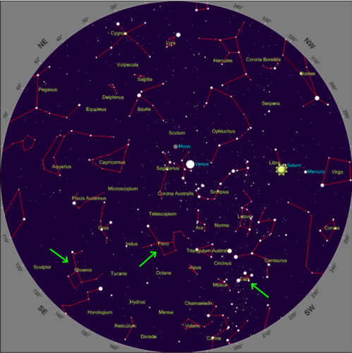
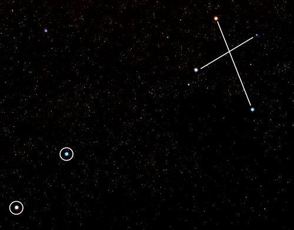
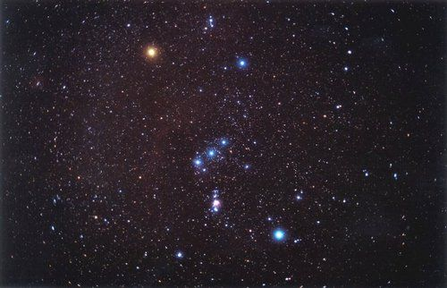

## Early viewing of space

In Grade 7 learners were introduced to indigenous knowledge about the stars and planets under the historical development of astronomy. This section focused primarily on the practical uses of star observations, such as timekeeping and navigation, along with an introduction to starlore associated with the Moon, Milky Way and other celestial bodies. In this section the focus will lie in the observations of constellations (and the planets) and starlore associated with one example constellation.

A good way to introduce the topic of the early viewing of space, is to ask learners if they know of any stories about famous constellations or the planets. This facilitates discussions about constellations visible in the sky and how the stars are actually related in space.

<Callout type="note" title="Note">
- constellation
- starlore
</Callout>

<Callout type="note" title="Note">
These workbooks were created by Siyavula with the help of contributors and volunteers. Read more about Siyavula here.[[link]](http://www.siyavula.com)[www.siyavula.com](http://www.siyavula.com)
</Callout>

In dark conditions away from city lights, thousands of stars are visible in the night sky. Early cultures around the world gazed at the stars in wonder. They noted the movement of the stars and planets across the sky and used this to mark the passage of time. People often grouped the stars they saw into patterns called **constellations***.* Early cultures tended to associate the stars and planets they saw in the night sky with animals or gods and told stories, which were passed on from generation to generation, about the patterns in the sky which were passed down from generation to generation.

<Callout type="note" title="Note">
Early telescopes were were used by merchants to spot approaching trade ships or pirates. Telescopes also gave rise to the first high-speed telecommunications networks, as spyglasses were used to observe signals from kilometers away.
</Callout>

<Callout type="note" title="Note">
Today professional astronomers formally recognise 88 constellations, 23 of which are in the southern hemisphere.
</Callout>

The stars that are visible depend upon your location on Earth and also the time of year. The southern sky, which we see from South Africa, is full of beautiful stars and several prominent constellations are visible in the sky including the Southern Cross or Crux, Orion and Pavo the Peacock.

In the following activities you will have the opportunity to observe the night sky and familiarise yourself with some of the most famous southern constellations.

<Callout type="note" title="Note">
Learn how to view the night sky with Google Earth.
</Callout>

# Using star maps to observe the night sky

In this activity learners will use the star map provided to identify three constellations in the night sky visible during September/October/November. If you want to generate a star map specific to your location and date you can freely download a sky map from [www.heavens-above.com](www.heavens-above.com). All you need to do is select the area from which you want to view, by clicking on 'select from map' or 'from database' and selecting your location. Your location will then be saved. You can then click on the 'Sky chart' link further down to view a map of the night's sky from your location at the current time. You can save and print this for learners. For example, here are the links to the sky maps for several places in South Africa.

A suggestion is to also organise this activity as a field trip at night. Go beyond the city lights to an area where you are able to view the stars more clearly without light interference. Also take note of when the full Moon occurs, as reflected light from the Moon can also interfere with star gazing.

| Location | Link |
| --- | --- |
| Bloemfontein | http://www.heavens-above.com/skychart.aspx?SL=1&SN=1&lat=-29.13333&lng=26.2&loc=Bloemfontein&alt=1398&tz=UCTm2 |
| Cape Town | http://www.heavens-above.com/skychart.aspx?SL=1&SN=1&lat=-33.91667&lng=18.41667&loc=Cape+Town&alt=268&tz=UCTm2 |
| Durban | http://www.heavens-above.com/skychart.aspx?SL=1&SN=1&lat=-29.85&lng=31.01667&loc=Durban&alt=24&tz=UCTm2 |
| Johannesburg | http://www.heavens-above.com/skychart.aspx?SL=1&SN=1&lat=-26.2&lng=28.08333&loc=Johannesburg&alt=1766&tz=UCTm2 |

**MATERIALS:**

- star map
- clear skies
- pencil
- paper or this workbook
- torch - optional

<Callout type="note" title="Note">
Create your own star map for your area.[www.heavens-above.com](www.heavens-above.com)
</Callout>

Below is an example star map of the Southern Hemisphere. Ignore the positions of the Moon and the planets. You can generate your own, customized star map for your exact location using the link in the **Visit** margin box.

**INSTRUCTIONS:**

2. Go outside at night with your star map.
4. Wait a few minutes to let your eyes adjust to the dark.
6. Try to identify the following constellations in the sky: Pavo, Phoenix and Crux (indicated with green arrows on the star map).
8. Draw a picture of each of the constellations as you see them.
10. See if you can spot any of the planets, these will not twinkle like the stars do.

**DRAWINGS:**

Draw your pictures in the space below. If you have used separate paper you can stick your pictures in here.

# Observing the Southern Cross (Crux)

In this activity learners will observe the Southern Cross constellation at least three times during the months of September and October. Learners should make sure that they try to observe the constellation at the same time each night.

The Southern Cross or Crux (top right) and the Pointers (bottom left).

**MATERIALS:**

- picture of the Southern Cross constellation and star map
- clear skies
- pencil
- paper or this workbook

**INSTRUCTIONS:**

2. Go outside around 8 pm with your star map (if in the Western half of the country, closer to Cape Town), or if you live in the Eastern half of the country, (closer to Johannesburg or Durban) go out an hour earlier around 7pm.
4. Wait a few minutes to let your eyes adjust to the dark.
6. Try to identify the Southern Cross constellation using the star map.
8. Draw a picture of the Southern Cross and the Pointers as you see them. Make a note of the date and time of your picture and in roughly which direction you are facing (north, south, east or west).
10. Draw or paste your image (if you have used separate paper) into the space below.
12. Repeat the observations at least twice so that you have a minimum of three observations on different nights, over the course of a few weeks, and try as best as possible to make your observations at the same time each night.

**DRAWINGS:**

**QUESTION:**

What did you notice about the orientation of the Southern Cross as you made your observations?

The constellation should appear to rotate in a clockwise direction over time. In early September its long axis is fairly horizontal in the sky but the constellation gradually rotates so that by early November its long axis is almost pointing downwards.

<Callout type="note" title="Note">
Stellarium - a free, open source programme for your computer to to generate a realistic, real-time 3D simulation of the night sky.[http://sourceforge.net/projects/stellarium/](http://sourceforge.net/projects/stellarium/)
</Callout>

<Callout type="note" title="Note">
Some people believe that the builders of the ancient pyramids of Giza in Egypt placed them specifically to look the same from above as the three "belt stars" of the constellation Orion look from Earth.
</Callout>

Although the stars appear to lie in patterns when viewed from the surface of the Earth, in reality the stars within a constellation are unrelated, and they can lie at vastly different distances from Earth. When we look at the stars at night, we only see a two dimensional projection on the sky of three dimensional space, as you can see in this photograph showing the constellation, Orion.

The Orion Constellation, seen here as the three bright stars in the middle making up Orion's belt and the 4 stars in each corner.

You might imagine that all the stars lie at the same distance from Earth. This isn't true, the stars lie at different distances. The closest star in Orion is called Bellatrix and is around 250 light years away. The furthest star Meissa is around 1100 light years away, roughly the same distance as the Orion nebula (1300 light years). But, when viewed from Earth, we see them making up a pattern in relation to each other.

Now that you are familiar with some of the constellations in the Southern sky, including the Southern Cross you can learn what some of the early cultures in Southern Africa thought about them.

<Callout type="note" title="Note">
Read more about traditional African starlore.[http://www.psychohistorian.org/display_article.php?id=200901111733_african_star_lore.content](http://www.psychohistorian.org/display_article.php?id=200901111733_african_star_lore.content)
</Callout>

As you can imagine there are many stories associated with the constellations in the sky. In the following activity you will carry out research to find an example story to tell to your class.

# Constellation starlore

This is a research activity for learners to complete. They will study ancient stories about a constellation of their choice. You can either provide them with books or printed resources or if they have access to the internet you could ask them to conduct an online search. You may ask learners to pick South African stories, or if you want, you could extend their research to other countries for comparisons with South African starlore. You can ask learners to present their story to the class either as an oral presentation or a poster, or if you wish you can turn this into a writing task.

The /Xam Bushman imaged that the two pointer stars of the Southern Cross were two male lions who had once been men before they were thrown up into the sky to be stars by a magical girl. The three brightest stars in the Southern Cross were seen as female lions, perhaps women also changed into stars by the magical girl.

The Khoikhoi thought that the Pointers were the eyes of some great beast and they were called *Mura* which means *the eyes*.

In Sotho, Tswana and Venda cultures, these stars are called *Dithutlwa* which means *the Giraffes*. The bright stars of the Southern Cross are male giraffes, and the two Pointer stars are female giraffes. The Venda named the fainter stars of the Southern Cross *Thudana*, which means *the Little Giraffe*. The Sotho used these stars to indicate the beginning of the cultivating season which began when the giraffe stars were seen close to the south-western horizon just after sunset.

**INSTRUCTIONS:**

2. Search for a story about a constellation found in the South African sky.
4. Use a South African starmap as a guide to the constellations found in South Africa.
6. Research information on the origin of the story and any beliefs associated with it.
8. Tell your classmates about the constellation and story you have found out about.
10. Your teacher will decide on the format of this presentation which might be a poster or oral presentation.

<Callout type="note" title="Note">
Read more about some South African starlore:[http://www.rmg.co.uk/explore/astronomy-and-time/astronomy-facts/stars/south-african-star-myths](http://www.rmg.co.uk/explore/astronomy-and-time/astronomy-facts/stars/south-african-star-myths) and [http://www.beforebc.de/AfricanaResources/AfricanaResources/AfricanStarlore.html](http://www.beforebc.de/AfricanaResources/AfricanaResources/AfricanStarlore.html)
</Callout>

In their quest to find out more about planets, stars and galaxies, people invented instruments to observe them in more detail. In the next section we will learn about the telescope: an invention used to study the stars.
