## Telescopes

In Grade 6 learners were introduced to telescopes including the Southern African Large Telescope (SALT) and the Square Kilometre Array (SKA). In this section learners explore how telescopes work in more detail. There is a particular focus on comparing the telescope with our eye. Simple ray diagrams are shown which link to material covered in Gr 8 Energy and Change, Chapter 4 on Visible Light.

Two case studies are explored in more detail: SALT and the SKA, and learners will find out why South Africa is an ideal location for professional telescopes.

<Callout type="note" title="Note">
- celestial
- telescope
- chromatic aberration
- primary mirror
</Callout>

<Callout type="note" title="Note">
History of the telescope.
</Callout>

Unfortunately, we cannot visit distant stars or galaxies to study them directly as they are so far away. Instead astronomers study stars and galaxies by analysing the visible light, radio waves and electromagnetic radiation that they receive from them. Human eyes can see very far. The Andromeda Galaxy which is 2.5 million light-years away is visible to the naked eye. However, we cannot make out any detail as it appears as only a tiny smudge on the sky to our eyes even though in reality it is 220 000 light years across.

<Callout type="note" title="Note">
The beauty of the night sky.
</Callout>

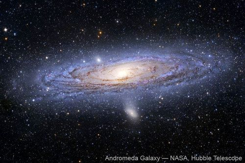

The Andromeda galaxy, viewed with the Hubble Space Telescope. Humans can only see it as a tiny faint smudge in the sky with the naked eye.

Light is emitted from stars and galaxies and travels in a straight line in all directions. When you look at a star, you only see the light rays that hit your eye. In Energy and Change, we learned about visible light. How is the energy of light transferred through space?

By radiation, as electromagnetic waves travel in straight lines.

The further away a star is, the more the starlight is spread out and so less of the total light from the star reaches your eye. This makes distant objects faint and difficult to see clearly. If we had huge eyes we would be able to see distant objects more clearly because our eyes would gather more of their light.

Do you remember making a pinhole camera in Energy and Change? Have a look at the following diagram which illustrates this again.

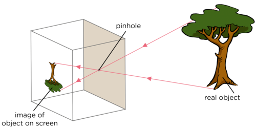

Which way is the image projected onto the screen?

The image is inverted, it is upside down.

<Callout type="note" title="Note">
Luminous objects, such as the Sun and other stars, emit light. The tree is NOT a luminous object as it does not emit its own light light. It reflects the light from the Sun.
</Callout>

This is the same way in which images are formed on your retina when you view an object, as shown in the following image.

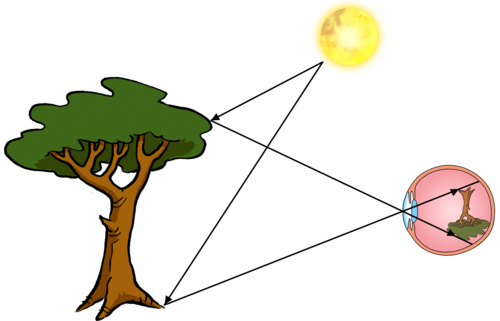

Images formed on the light-detecting retina at the back of your eye are upside down.

An object that is far away projects a small image of the object onto the retina at the back of your eye making it difficult to see fine details in the image.

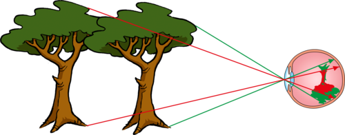

More distant objects appear smaller on our retina.

Telescopes help us see faint, distant objects more clearly because they collect more light from the objects than our eyes do. They also magnify the image.

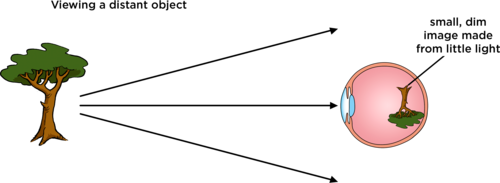

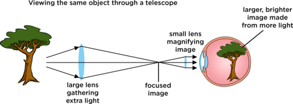

In the image above the tree is upside down in the top eye because images on the retina are upside down. In the bottom eye the tree is the right way up because the telescope inverts the image of the tree.

As revision of what we learned in Energy and Change last term, answer the following questions.

What type of lens is shown in the above image?

A biconvex lens.

What happens to the light when it passes through the lens?

The light is refracted and the light rays converge as the light passes from one medium to another.

<Callout type="note" title="Note">
Images formed on your retina are actually upside down. Your brain "corrects" the image, so that you do not notice.
</Callout>

Let's take a closer look at how a telescope works.

<Callout type="note" title="Note">
How telescopes work.
</Callout>

# Telescopes as light buckets

In this activity learners will discover how a telescope collects more light than our eyes can and as a consequence can help us to see fainter and more distant objects. As well as demonstrating how telescopes collect light, this activity also shows learners how telescopes focus light from distant objects to a point. This activity introduces the concept of photons, or packets of light. This is not a formal part of the curriculum in Gr 8, and is not explained in detail. The idea that a finite amount of light hits a telescope mirror or eye per second is crucial to this activity and the understanding of why telescopes are useful. If you feel that you would rather omit the concept of photons, you could instead talk about the rice grains representing rays of light.

There is only so much light emitted from an object each second. Little packets of light are called **photons**. Our eye needs at least 500 photons, or packets of light, coming into it every second for our brains to sense that something is there. In this activity you are going to represent photons from a distant galaxy using pepper grains or hundreds and thousands.

**MATERIALS:**

- paper plate
- piece of paper 3cm by 3cm
- pencil or pen
- torch
- pepper grains or hundreds and thousands
- wooden skewers
- foam (bath sponge will do, ideally as wide as the paper plate in one direction)
- tape - optional
- scissors

The wooden skewers used for making kebabs or sosaties are ideal for this activity.

**INSTRUCTIONS:**

2. On the piece of paper draw an image of your eye including the pupil and iris.
4. Tape or place the image of your eye onto the middle of a paper plate. The paper plate represents a telescope mirror or lens.
6. Take the foam and cut it into a thin strip about 3 cm wide and as long as the paper plate across.
8. Stick six skewers into the foam equally spaced along the strip. Trim the pointed edges off that are sticking out for safety. You will use this foam strip later in this activity.
10. Shine a torch light just above the picture of the eye on the plate.
   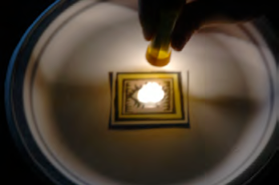
   When an object is closer, more light reaches your eye.

2. Slowly move the torch further away from the plate and watch how the light spreads out and dims.
   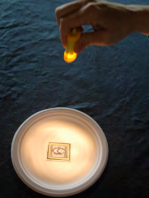
   The further away an object, the less light that reaches your eye.
4. Note how much of the torch light the eye's pupil receives compared to the paper plate.
6. Now remove the torch and get ready to use the pepper grains or hundreds and thousands. These will represent *photons* or *packets of light.*
8. Sprinkle these photons for one second over the plate.
   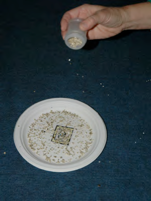
   Sprinkle the pepper grains or hundreds of thousands.
10. Note roughly how many photons get into the eye compared with how many hit the paper plate representing the telescope mirror or lens.
12. Now place the foam across the centre of the paper plate. The skewers should be pointing straight up. This represents a strip of the telescope mirror with the skewers representing light rays from distant objects.
   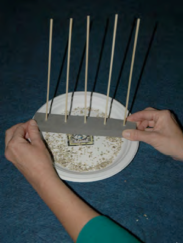
   The skewers represent the light rays hitting the mirror of the telescope.
14. The telescope mirror is actually curved. Bend the foam upwards at either end so that the skewers begin to come together in the middle.
16. Turn the foam over and direct the skewers into the picture of the eye. The light rays from a large strip of the mirror are now entering the small pupil of the eye.
   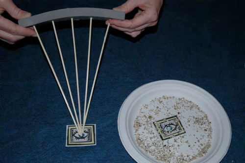
   Now you can see how a telescope's mirror can collect lots of light and direct it into a small detector, like your eye.

**QUESTIONS:**

**Problem:**
Which collects more of the torch light as the torch moves further away: the eye's pupil or the paper plate?

**Solution:**
The paper plate.

**Problem:**
Did the eye collect enough photons in one second to detect the light?

**Solution:**
No.

**Problem:**
Did the telescope mirror (paper plate) collect enough photons for the eye to detect the light?

**Solution:**
Yes.

**Problem:**
How do you think all the light that hits the telescope mirror is concentrated so that it can enter our eyes or a small telescope detector?

**Solution:**
The telescope mirror has a curved surface and reflects the light hitting it, therefore causing the light to focus at a point.

<Callout type="note" title="Note">
How to make a small, easy telescope.
</Callout>

Telescopes have big lenses or mirrors to collect as much light as possible. This is how they are able to see faint objects. Telescopes also concentrate or focus the light and redirect it into our small eye so that we can see the dim object. Alternatively, telescopes can redirect the light into special detectors that record images, similar to a cell phone camera.

# Compare your eye with SALT

This is an **optional** activity. In this activity learners work in pairs. Learners should estimate that their reaction time is of the order of 1/10th of a second. But as long as they estimate 1s or less this is perfectly fine. They will use this value as their eye's exposure time. In fact roughly every 1/15th of a second, the eye sends the brain another image. So the eye has about one-fifteenth of a second to collect light when making an image.

The Southern African Large Telescope (SALT) takes pictures of some of the most distant and faintest objects in the Universe. SALT's camera takes images with exposure times typically of twenty minutes, after which the camera shutter closes and the resulting image is displayed on a computer. The longer the exposure, the more light that the telescope can gather to make the image. The human eye does not have a shutter. We seem to see continuously, rather than as a succession of still images. However, the eye does have a kind of exposure time. In this activity you will estimate the exposure time of your eye by estimating your reaction time and then compare it with SALT's typical exposure time.

**MATERIALS:**

- ruler
- calculator
- pencil or pen

**INSTRUCTIONS:**

2. Work in pairs for this activity.
4. Look at your partner's eyes. Estimate the diameter of their pupils using a ruler held close to their eye. Be careful not to actually touch your partner's eyes.
6. Write down the diameter of pupil in the table below.
8. Compare the diameter of the pupil with that of the Southern African Large Telescope (SALT) which is roughly 10 m in diameter.
10. Calculate how many times larger than an eye SALT is. (Remember to compare the areas rather than the diameters).
12. One of the pair: hold a pen or pencil directly in front of you, while the other person stands opposite you and prepares to catch it.
14. Drop the pen or pencil and see if you partner can catch it.
16. Estimate the reaction time of your partner. Is it a second? Is it a tenth of a second? Is it a thousandth of a second?
18. Repeat steps 6 - 8 swapping places.
20. Fill in your reaction times in the table below, these represent the exposure time of your eye.
22. Complete the questions.

Table to record your results:

|  | Eye | SALT | SALT / Eye |
| --- | --- | --- | --- |
| Diameter of collecting lens / mirror | ________ cm | ________ cm |  |
| Area of collecting lens / mirror | ________ cm 2 | ________ cm 2 |  |
| Exposure time | ________ seconds | ________ seconds |  |

Hint: Convert the diameter of SALT to cm. Convert the exposure time of SALT to seconds. To simplify the calculation of the area of the SALT mirror assume it is a circle with a radius of 5 m. The area of a circle is given by the formula A = πr2

**QUESTIONS:**

**Problem:**
Why should you compare the area of the telescope and eye's pupil rather than their diameters?

**Solution:**
Light is collected over the area of your pupil and over the whole area of the telescope.

**Problem:**
How many times more light does the SALT telescope collect compared with your eye?

**Solution:**
Learner-dependent answer. Assuming a pupil diameter of 0.5 cm and a SALT mirror diameter of 10 m the answer is 4 000 000 ((1000 cm x 1000 cm) / (0.5 cm x 0.5 cm))

**Problem:**
What would happen to your reaction time if your eye had to accumulate light over a longer interval before sending an image to the brain?

**Solution:**
It would increase. Note that this experiment shows us that we do not see or react instantaneously. It takes time for the image of the moving pencil to be recorded and for us to react, so we do have a kind of exposure time.

**Problem:**
How many times longer can SALT expose for than your eye?

**Solution:**
Learner-dependent answer. Assuming a reaction time of 1/10th second and a SALT exposure time of 20 minutes the answer is 12,000 (20 x 60s / 0.1s).

Telescopes can collect more light from faint and distant objects because they have larger collecting areas *and* because they can accumulate light over longer periods of time to make an image. This means that you can see fainter objects with telescopes that you would be able to see using just your eye.

Telescopes also **magnify** (enlarge) the image that you see, so it takes up more room on your retina allowing you to see the object more clearly.

A convex (converging) lens used as a magnifying glass. The resulting image is larger than the object. Telescopes magnify images from distant stars and galaxies.

Magnification comes at a price however. A fixed amount of light is received from any object, so if you make the image larger, its gets fainter as the light is spread out within the image. This is why it is so important to collect as much light as possible.

**Extension content on another advantage of telescopes, namely angular resolution**

Telescopes also have another advantage over the eye. Telescopes can better distinguish between objects that are close together on the sky. The ability to see things that are close together as separate objects rather than seeing one smeared or fuzzy object results in a sharper image. In astronomy, "close together" means "separated by a small angle on the sky," so astronomers refer to the **angular resolution** of a telescope. The higher the angular resolution of a telescope, the better it is at seeing narrowly separated objects as individual objects and the sharper the images look.

The images below show what photographs of the same galaxy look like with different angular resolutions.

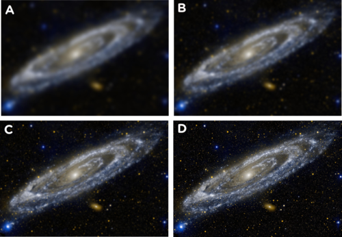

The same galaxy viewed with increasing angular resolution from (A) to (D). The image gets sharper with increasing angular resolution. In (A) the telescope is able to distinguish between objects separated by an angle of only 1/6 of a degree or more. In (D) the telescope can see objects separated by an angle of only 1/3600 of a degree or more.

In the following activity learners will measure the angular resolution of your eye and then compare it with that of the SALT telescope.

**Activity: Measuring the angular resolution of your eye**

*
**Note**: This is an **advanced, extension activity**. The practical side of this activity is fairly simple and involves measuring distances using a ruler and a measuring tape. This activity also involves a calculation of an angle using a trigonometric identity which is more advanced, and learners only cover this in Mathematics in the higher grades. If you would like to perform this activity with learners, you can get them to take the measurements, and you calculate the angles.
                *

**MATERIALS:**

- torch
- square of aluminium foil large enough to cover head of the torch - one per group
- pin
- measuring tape
- chalk
- ruler
- tape
- calculator

**INSTRUCTIONS:**

2. Prick two fairly large pinholes through a square of aluminum foil, about a third of a cm apart, using a pin.
4. Place the foil over the end of the torch, tape it on around the edges if needed.
6. Measure the exact distance between the pinholes using a ruler.
8. Turn on the torch, you should be able to clearly see light coming through both pinholes.
10. While one of your group holds the torch up, the other members of the group should stand as far as possible from the torch, for example, at the other end of a corridor.
12. Each of the group members not holding the torch: slowly move towards the torch until you can just make out that there are two points of light side by side, rather than one point of light. This is the distance at which you can just resolve the two objects. Each of the group members not holding the torch: mark on the ground your distance from torch using chalk.
14. Each of the group members not holding the torch: measure the distance from the torch to the chalk mark using measuring tape.
16. One group member swap with the person holding the torch so that they have a chance to measure their distance from the torch.

**QUESTIONS:**

Fill in the table below.

The angle subtended between the two pinholes is equal to 2a. The angle a is given by

a = tan-1 (0.5 x the distance between pinholes / the minimum distance to see the pinholes)

| Distance between the pinholes (cm) |  |
| --- | --- |
| Minimum distance where you could see two pinholes (cm) |  |
| Angle subtended by the pinholes at the distance above |  |

An example calculation:

| Distance between the pinholes (cm) | 0.3 cm |
| --- | --- |
| Maximum distance where you could see two pinholes (cm) | 10.5 m = 1050 cm |
| Angle subtended by the pinholes at the distance above | a = tan-1 (0.5 x 0.3 / 1050) = 0.009 2a = 0.018 degrees ~ 1/60th degree. |

Given that the smallest angle that the SALT telescope can resolve is around 0.00016 degrees, do you think that SALT or your eye would produce sharper images of a distant object?

*Answer: SALT has a higher angular resolution, it can resolve (distinguish) objects that are separated by smaller angles than the eye, and so SALT would produce sharper images of a distant object.*

The larger a telescope's mirror or lens, the better it is at seeing narrowly separated objects as individual objects and the sharper the images look.

The most important feature of a telescope is how much light it can collect, which depends upon the area of the lens or mirror. The larger the light collecting area, the more light a telescope gathers and the higher resolution (ability to see fine detail) it has. So the size of a telescope is far more important than its magnification.

**Misconception about magnification:**

Many students want to know how much a telescope "magnifies" an image as they think this is the most important characteristic of a telescope. Telescopes do magnify images but this is not the main reason why they are so useful. After all, a magnified dim image would still be dim and difficult to make out and a magnified blurry image would still be blurry and wouldn't help you see anything. Astronomers care more about how much light the telescope can collect and also its angular resolution: how bright, sharp and clear its images are. These properties both depend upon the size of the collecting mirror or lens rather than the magnification. With telescopes, bigger really is better.

Now that we have briefly looked at how telescopes work, we are going to look at the different types of telescopes, namely:

- optical telescopes
- radio telescopes
- space telescopes

### Optical telescopes

Optical telescopes collect visible light from celestial objects. There are two types of optical telescopes.

2. Refracting telescopes use **lenses** to collect and focus the light from distant objects.
4. Reflecting telescopes use **mirrors** to collect and focus the light from distant objects.

<Callout type="note" title="Note">
The atmosphere and optical telescopes.
</Callout>

### 1. Refracting telescopes

Refracting telescopes use a converging (convex) lens to collect and bend the light rays inwards to the focal point (also called the focus) of the telescope. The light collecting lens is called the objective lens.

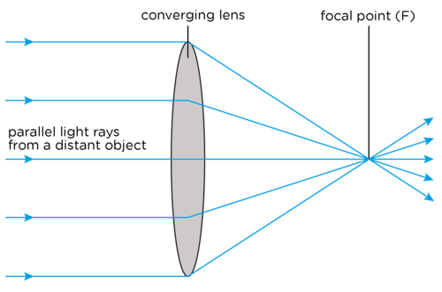

<Callout type="note" title="Note">
As astronomical objects are so far away, their light rays are considered to be parallel to each other.
</Callout>

Once light is brought to a focus, it is then magnified by another lens called the eyepiece lens. Look at the optical ray diagram below showing a simple refracting telescope.

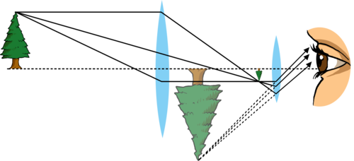

The telescope objective lens collects and focuses the light from a distant tree forming a real inverted image of the tree. The eyepiece lens, like a magnifying glass, then enlarges the image collected by the objective lens, producing a larger, virtual image. This images is what we see when we look through the telescope.

What kind of lenses are the objective lens and the eyepiece lens?

Both of the lenses are convex lenses which means that they cause light rays to converge or come together.

<Callout type="note" title="Note">
A**real image** is called real because light rays actually pass through the point where the image is formed. A **virtual image** is called a virtual image because the light rays do not actually come from the image, they just appear to have come from the image.
</Callout>

Look at the picture below which shows how white light is refracted (bent) as it travels through a prism. As we learned in Energy and Change, when light travels through glass it slows down and so it bends or refracts.

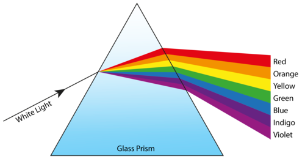

Do all the colours undergo the same amount of refraction? Which colour is bent the most?

No, Violet is bent the most. Bluer colours are slowed more than redder colours and so they are bent or refracted more.

White light is a mixture of all the colours of the rainbow. Different colours are refracted by different amounts as they travel through the prism so the white light is split into its different colours. How do you think this affects the images produced by refracting telescopes?

Learner-dependent answer. Answers could include that the images could look colour-separated and blurry.

Lenses are shaped to bend light by a certain desired amount. However, the different colours that make up white light bend by slightly different amounts. This means that different colours come to a focus at slightly different distances from the objective lens. Each colour will produce its own image and they will be slightly misaligned with each other resulting in a slightly blurry image. This effect is called **chromatic aberration** and all lenses suffer from this effect.

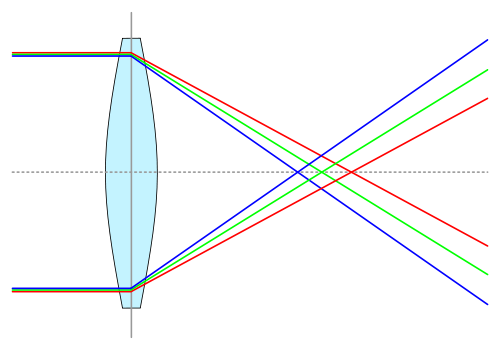

Blue light is bent more than red light and so different colours are focused at different distances from the lens. The different coloured images are overlaid upon each other and, because they are misaligned, the resulting image is blurry.

The main disadvantages of refracting telescopes are:

2. Light travels through the lenses in the telescope and so the lenses have to be perfect. There must be no bubbles of air in the glass which would distort the image. It is difficult to and expensive to make large perfect lenses.
4. The light travels through the lenses and so they can only be supported around their edges, where they are thinnest and weakest. This limits the size of refracting telescopes because if a lens is too large it will sag under its own weight and distort the image.
6. Lenses suffer from chromatic aberration which blurs the image.

### 2. Reflecting telescopes

In the 1680s, Isaac Newton invented the reflecting telescope. Reflecting telescopes use a curved primary mirror to collect light from distant objects and reflect it to a focus.

<Callout type="note" title="Note">
The first successful reflecting telescope built was the Newtonian Telescope, by Isaac Newton, which is where the design gets its name.
</Callout>

<Callout type="note" title="Note">
Remember that for each ray, the angle of incidence is equal to the angle of reflection, as you learned in Energy and Change.
</Callout>

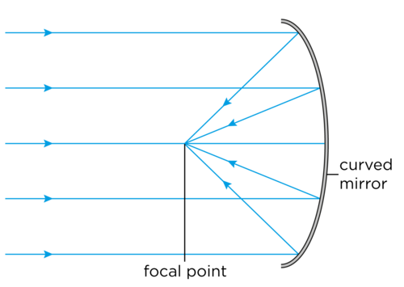

There are many different types of reflecting telescopes. A **prime focus reflector** is the simplest type of reflector telescope. In this design, a recording structure is placed at the focal point to obtain the focused image. In the old days, in very large telescopes, a person would actually sit in an "observing cage" to view the image directly or operate a camera. However, now a detector is used and is operated from outside of the telescope. The position of the detector is shown in the following diagram with a red cross.

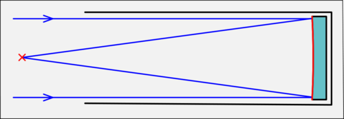

A prime focus reflector with a detector at the focal point, marked with an X.[http://en.wikipedia.org/wiki/File:Prime_focus_telescope.svg](http://en.wikipedia.org/wiki/File:Prime_focus_telescope.svg)

More complex designs of reflecting telescopes use a secondary small mirror to reflect the light towards the eyepiece lens.

- A **Newtonian reflector** reflects the light to an eyepiece on the side of the telescope tube. This design is often used for amateur telescopes because having the eyepiece on the side of the tube makes the telescope easy to use.
- A **Cassegrain reflector** reflects light through a small hole in the primary mirror. This kind of telescope is often used for large professional telescopes as it allows heavy detectors to be placed at the bottom of the telescope. This makes them easy to reach for repairs and also means that the weight of the detectors does not affect the telescope tube.

<Callout type="note" title="Note">
The Cassegrain reflector is named after a reflecting telescope design that was published in 1672 and has been attributed to Laurent Cassegrain.
</Callout>

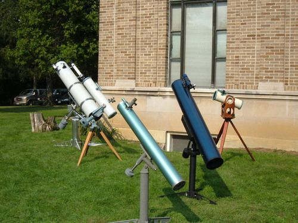

A group of Newtonian telescopes.

The following ray diagrams show the difference between a Newtonian and Cassegrain reflector.

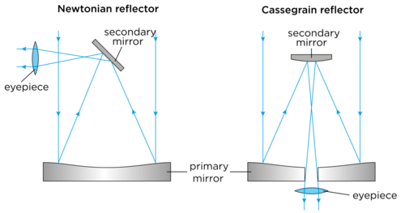

Ray diagrams for some example reflecting telescopes. The Newtonian reflector is often used in amateur telescopes. The Cassegrain telescope is often used at large observatories.

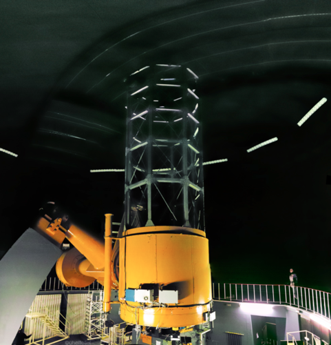

The SAAO 1.9 m reflecting telescope. Detectors are bolted onto the Cassegrain focus at the bottom of the telescope (metal boxes under the orange tubing). (Credit: SAAO).

The secondary mirror in a reflecting telescope must be very small. Why do you think this is so?

So that it does not block much light from the distant object as it travels to the primary mirror.

Do you think that reflecting telescopes suffer from chromatic aberration? Why?

No, they do not, because they do not use a lens to collect and focus the light, but rather use mirrors which reflect light.

The advantages of a reflecting telescope include:

2. The glass of the mirror does not have to be perfect throughout, only the surface has to be perfect.
4. The mirror can be supported across the whole of its back so it won't sag.
6. Making large mirrors is easier and cheaper than making big lenses.
8. They do not suffer from chromatic aberration.

Optical telescopes on the ground do however have some disadvantages:

2. They can only be used at night.
4. They cannot be used in bad weather (rain, cloud, snow etc).

Optical telescopes are best placed on the tops of remote mountains. Discuss within your class why you think this is. Take some notes in the space below.

This is a good opportunity to get learners to think about the conditions needed to make good observations of very faint objects. You may need to lead the discussion. They should understand that ideally they should collect as much light from the object with minimal stray light from other sources. You can lead the discussion by first asking them what the air is like on the top of mountains and also what the weather is like and asking them about how bright they think the sky is up a mountain compared to in a city. Possible answers include:

2. They are far away from the light pollution from large cities and towns
4. They are above dust and other types of atmospheric pollution.
6. They are above low cloud.
8. The air is thinner and so there is less absorption of the starlight by the Earth's atmosphere.
10. There is less air turbulence resulting in sharper images.

The largest telescopes in the world today are reflecting telescopes. In the next section you will learn about one of the largest reflecting telescopes in the world which is located right here in South Africa.

### SALT

<Callout type="note" title="Note">
- SALT
</Callout>

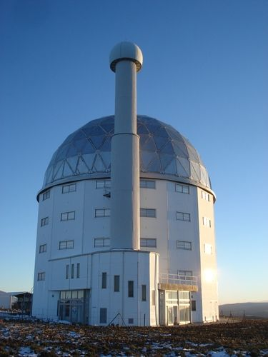

The SALT telescope just outside Sutherland.

<Callout type="note" title="Note">
The SALT website.[http://www.salt.ac.za/](http://www.salt.ac.za/)
</Callout>

The Southern African Large Telescope (SALT) is the largest optical telescope in the southern hemisphere and among the largest in the world. SALT was completed in 2005 and is located in the Karoo in the Northern Cape, near the town, Sutherland. Astronomers use telescopes like SALT to study planets, stars and galaxies. SALT can detect the light from faint or distant objects in the Universe a billion times too faint to be seen with the naked eye.

The SALT telescope has a large mirror which collects light. SALT's primary mirror is a hexagonal shape measuring 11.1 m by 9.8 m across and is made up of 91 individual 1.2 m hexagonal mirrors. SALT is a prime focus reflector. What does this mean?

It does not have a secondary mirror to reflect the light to an eyepiece, but rather a detector located at the focal point.

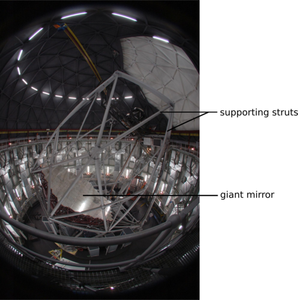

SALT's giant mirror, made up of 91 individual mirrors.

<Callout type="note" title="Note">
The Southern African Large Telescope (video).
</Callout>

SALT does not have a telescope tube. Instead there is a network of metal struts which support the tracker and payload at the top of the telescope. The whole telescope structure weighs 85 tons. The payload contains detectors which take pictures of the night sky.

Stars move during the night just as the Sun moves across the sky in the day. The telescope must follow the stars as they move. The tracker at the top of SALT is used to follow the drifting stars carrying the detectors along with it as it tracks the stars.

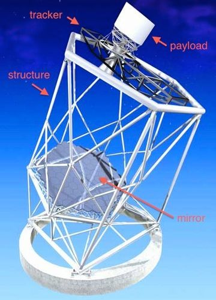

The SALT telescope structure. (Credit: SALT)

SALT is currently being used to study stars, in particular binary star systems where two stars orbit around each other. Astronomers also use the telescope to study galaxies and some of the most violent explosions in the Universe called supernovae and Gamma Ray Bursts which occur when massive stars explode at the end of their lives. SALT is also looking at the Universe on the largest of scales, in order to answer the questions how did the Universe begin, and what will happen to it in the future?

The Karoo is an ideal place to host SALT because it is far away from towns and cities so there is very little light pollution. The area is also at a high elevation, dry and there are no extreme weather conditions, such as flooding or storms. Despite it being so remote at the observatory site there is good infrastructure, including roads and electricity, in the surrounding area of Sutherland.

### Radio telescopes

<Callout type="note" title="Note">
- antenna
- receiver
- amplifier
- SKA
</Callout>

<Callout type="note" title="Note">
What is a radio telescope?
</Callout>

Radio waves are a type of electromagnetic radiation (or light) that humans cannot see with their eyes. They have very long wavelengths compared to optical light. Purple light, for example, has a wavelength of 400 nm whereas red light has a wavelength of 700 nm. Radio wavelengths are much longer; radio waves have wavelengths from approximately one millimeter to hundreds of metres.

<Callout type="note" title="Note">
Do you remember learning about wavelength in Energy and Change? A wavelength is the distance between two corresponding points on two consecutive waves.
</Callout>

Radio telescopes detect radio waves coming from distant objects. Radio telescopes have several advantages over optical telescopes. They can be used in bad weather, as radio waves are not blocked by clouds. They can also be used during the day and at night.

Many objects in space emit radio waves, for example some galaxies, stars and nebulae which are giant clouds of dust and gas where stars are born. Some objects emit radio waves but do not emit optical light, therefore looking at the sky at radio wavelengths reveals a completely different picture of our Universe. If your eyes could see radio waves at night, rather than white light, instead of seeing pointlike stars, you would see distant star-forming regions, bright galaxies and beautiful giant clouds around old exploded stars.

<Callout type="note" title="Note">
Atacama Large Millimeter/sub-millimeter Array (ALMA) is a new radio telescope in Chile's Atacama desert. It will open an entirely new 'window' into the Universe, allowing scientists to search for our cosmic origins.
</Callout>

<Callout type="note" title="Note">
Watch a video on some of the latest research and images released from ALMA.
</Callout>

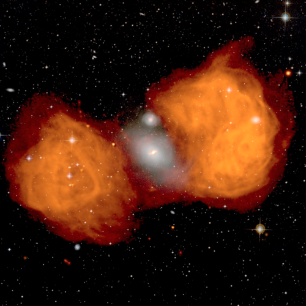

An optical (white) and radio (orange) image of the galaxy NGC 1316. The radio emission spans over one*million* light years and engulfs the optical light at the centre.

<Callout type="note" title="Note">
Rapidly rotating star remnants, called pulsars, were first discovered using a radio telescope in 1967. Astronomers initially considered the possibility that the regular pulses of radio waves were signals from an alien civilisation but quickly realised that this was not the case.
</Callout>

Radio telescopes typically look like large dishes. The **dish** or **antenna**, acts like the primary mirror in a reflecting telescope, collecting the radio waves and reflecting them up to a smaller mirror which then reflects the radio waves to a radio wave detector. Radio wave detectors are called **receivers**. An **amplifier** amplifies the signal and sends it to a computer which processes the information from the receiver to create colour images which we can see.

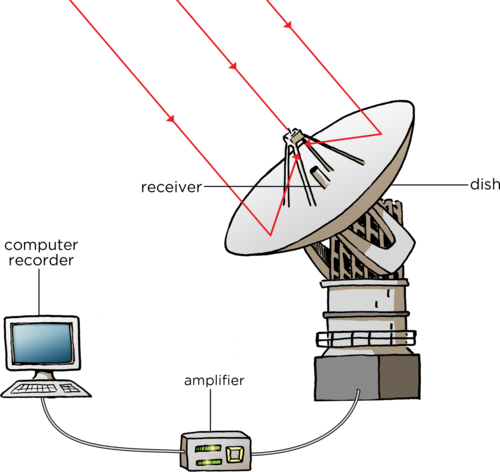

<Callout type="note" title="Note">
The sensitivity of a radio telescope depends upon the area of the collecting dish and the sensitivity of the radio receiver. In order to produce sharp radio images comparable to images from optical telescopes a radio telescope must be much larger than an optical telescope.
</Callout>

**Background information**

This is because the angular resolution depends not only on the diameter of the collecting mirror but also upon the wavelength of the light. The minimum angle at which two objects can be distinguished on the sky is proportional to the wavelength of light used and inversely proportional to the diameter of the collecting mirror. As radio waves are much longer than visible light, the diameter of the collecting mirror must increase to compensate if you require the same angular resolution.

Radio telescopes need to be placed far away from cities and towns as man-made radio interference can interfere with the telescope's observations.

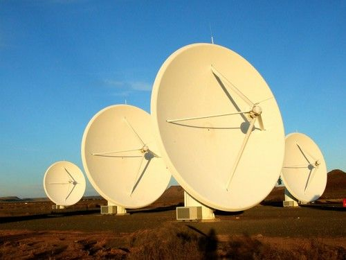

Part of the KAT-7 radio telescope array in the Northern Cape.

### MeerKAT and the SKA

<Callout type="note" title="Note">
The SKA central computer will have the processing power of about one hundred million computers. The dishes of the SKA will produce 10 times the global internet traffic.
</Callout>

The MeerKAT radio telescope array is currently under construction in the Northern Cape. MeerKAT is scheduled to be complete in 2016 and when it is finished it will have 64 radio dishes each 13.5 m in diameter. The MeerKAT array will be the largest and most sensitive radio telescope in the southern hemisphere until the Square Kilometre Array (SKA) is completed around 2024.

<Callout type="note" title="Note">
A video on the SKA.
</Callout>

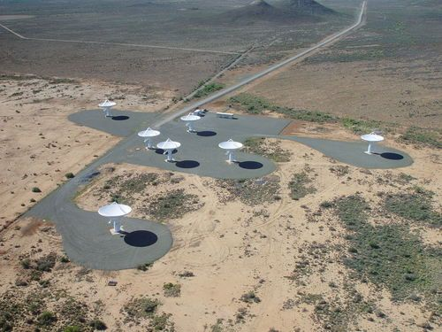

The KAT-7 test array in the Northern Cape is a test array for the larger MeerKAT array.

The Square Kilometre Array (SKA) will be the most powerful telescope ever. It will have a total collecting area of one square kilometer. It will have 3000 radio dishes each about 15 m wide which will act together as one large telescope. As well as the 3000 radio dishes there will be two other types of radio wave detectors.

Many different countries are working together to build, and pay for, the SKA. At least 13 countries and close to 100 organisations are already involved, and more are joining the project. Most of the SKA will be located in South Africa. There will also be locations in Australia and some stations in eight African partner countries namely, Botswana, Ghana, Kenya, Madagascar, Mauritius, Mozambique, Namibia, and Zambia.

<Callout type="note" title="Note">
The data collected by the SKA in a single day would take nearly two million years to playback on an ipod.
</Callout>

The location of SKA in South Africa, and other African countries.

<Callout type="note" title="Note">
Read more about SKA online.[http://www.ska.ac.za/](http://www.ska.ac.za/)
</Callout>

MeerKAT and the SKA will be used to investigate how galaxies change over time, our understanding of gravity, the origin of cosmic magnetism, how the very first stars formed, other planets around other stars, and whether we are alone in the Universe.

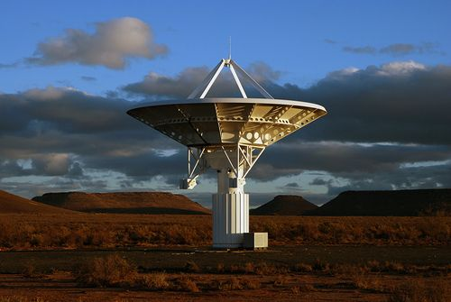

One of the SKA dishes.

<Callout type="note" title="Note">
The SKA will be so sensitive it could detect TV signals from planets orbiting other stars.
</Callout>

<Callout type="note" title="Note">
Radio astronomy observatories use diesel cars around the telescopes because the ignition of the spark plugs in petrol cars can interfere with radio observations.
</Callout>

# Careers in Astronomy

In this activity learners will discuss the sorts of jobs that are available in astronomy. As well as astronomers, facilities like SALT and the SKA need engineers, technicians, computer scientists, project managers, HR professionals, accountants and administrative staff. This is a creative and challenging activity for learners to imagine what contribution they could make to astronomy in South Africa.

**INSTRUCTIONS:**

Discuss in class with your teacher and classmates what sorts of careers you think are now available in astronomy in South Africa because of the construction of SALT and MeerKAT / SKA. Think about and discuss the skills needed in each of the roles you discuss.

<Callout type="note" title="Note">
Jobs are not just limited to astronomers: engineers, computer scientists and administrative staff are needed to run the telescopes.
</Callout>

<Callout type="note" title="Note">
Curious about the Universe, but don't know where to start? Have a look at this step-by-step guide to becoming an awesome amateur astronomer.[[link]](http://www.unawe.org/awesome/)[http://www.unawe.org/awesome/](http://www.unawe.org/awesome/)
</Callout>

# Draw a telescope

In this activity learners choose a telescope they want to focus on and a draw a picture of the telescope labelling the parts and describing what each part does. They can use the examples in this chapter or they can search online for examples of optical and radio telescopes.

**MATERIALS:**

- paper
- pencils or crayons

**INSTRUCTIONS:**

2. Pick either an optical telescope or radio telescope and draw a picture of the telescope.
4. Label the different parts of the telescope and describe what they do.

### Space telescopes

<Callout type="note" title="Note">
How many people are in space right now? Find out here.[[link]](http://www.howmanypeopleareinspacerightnow.com/)[http://www.howmanypeopleareinspacerightnow.com/](http://www.howmanypeopleareinspacerightnow.com/)
</Callout>

Radio waves and visible light form part of what is called the electromagnetic spectrum of light. There are other types of light at different wavelengths that we cannot see with our eyes including X-rays, ultraviolet and infrared light.

<Callout type="note" title="Note">
You will learn more about these different types of light if you continue with Physical Sciences in Grade 10.
</Callout>

The Earth's atmosphere blocks X-rays, ultraviolet and infrared light and stops them from reaching the ground. So if we want to observe this kind of light from stars and galaxies, we need to put telescopes in space. This is why X-ray telescopes and infrared telescopes are placed in space.

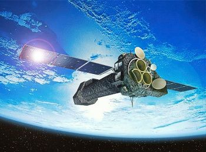

A picture of an X-ray telescope called XMM-Newton.

<Callout type="note" title="Note">
The Hubble Space Telescope is named after Edward Hubble, considered to be one of the most important cosmologists of the 20th century. Hubble discovered there were galaxies beyond our own and helped confirm that the universe is expanding.
</Callout>

The advantages of space telescopes are that they can observe the whole sky and operate during both night and day. Images taken with space telescopes are far sharper than images taken with telescopes on the ground, because images are not smeared or blurred by turbulence in the Earth's atmosphere, as with images take from ground telescopes. This is why the Hubble Space Telescope images are so detailed even though it is a relatively small reflective telescope. The major disadvantages of space telescopes are their costs and the fact that if something goes wrong they are extremely difficult to fix.

<Callout type="note" title="Note">
The Hubble Space Telescope (videos) and  and some of the best images from Hubble
</Callout>

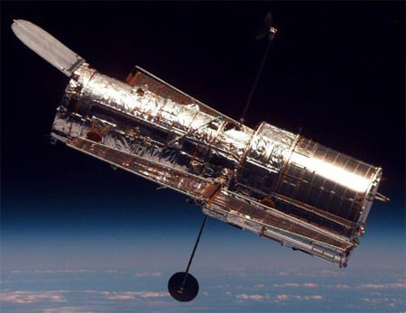

The Hubble Space Telescope has a 2.4m diameter collecting mirror.

<Callout type="note" title="Note">
NASA is currently planning the successor for the Hubble Space Telescope, called the James Webb Space Telescope (JWST). It will be launched into space in 2018.
</Callout>

<Callout type="note" title="Note">
Learn more about the James Webb Space Telescope (video).
</Callout>

# Telescope information poster

In this activity learners will make a poster about a specific telescope they have conducted research on. They can choose any type of telescope including ground-based and space telescopes. They should describe how the telescope works and provide some examples of the sorts of astronomy that the telescope is used for.

**MATERIALS:**

- paper
- pencils or crayons
- pictures downloaded from the internet or copied from books - optional

**INSTRUCTIONS:**

2. Pick a telescope that you want to make a poster about. It can be a ground-based or space-based telescope.
4. Describe the telescope and explain how it works. Include a diagram or picture of the telescope and label its main parts in your poster.
6. List some of the science that the telescope is used for in your poster.
8. List some of the advantages and disadvantages of the type of telescope you have chosen in your poster.

<Callout type="note" title="Note">
Science is about curiosity, discovery and innovation!
</Callout>

<Callout type="note" title="Note">
The concept maps in your workbooks were created at Siyavula using an open source programme. You can download it from this link if you want to use it to create your own concept maps for your other subjects.[[link]](http://cmap.ihmc.us/download/)[http://cmap.ihmc.us/download/](http://cmap.ihmc.us/download/)
</Callout>

<Callout type="note" title="Note">
- Early cultures observed the stars and grouped them together in patterns or constellations.
- Telescopes allow astronomers to see distant, faint objects in more detail.
- The performance of a telescope is measured by how much light it can collect. Larger telescopes can collect more light and see finer details than smaller telescopes.
- Optical telescopes detect optical light from distant objects.
- Most modern day optical telescopes use mirrors to collect and focus the light from distant objects.
- Radio telescopes collect and focus radio waves, emitted from distant objects in space.
- South Africa is host to one of the the most advanced optical telescopes in the world, the Southern African Large Telescope (SALT).
- South Africa will also host a large part of the soon to be constructed SKA radio telescope which will be the largest radio telescope in the world once complete.
</Callout>

**Concept Map**

The concept maps in this workbook we made using an open source, free programme. If you would like to make your own concept maps for your other subjects, you can download the programme from the link in the visit box.

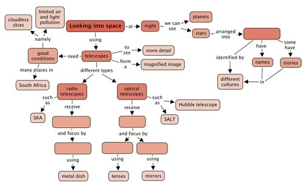

Teacher's version

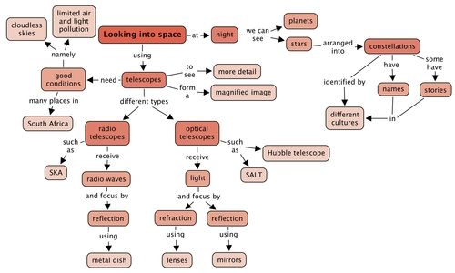

# Revision questions

**Problem:**
What do astronomers call patterns of stars in the sky? [1 mark]

**Solution:**
Constellations.

**Problem:**
Name three famous southern constellations. [3 marks]

**Solution:**
Learner-dependent answer. Answers could include, Orion, the Southern Cross, Pavo the Peacock, the Phoenix.

**Problem:**
What do optical refracting telescopes use to collect and focus light from distant objects? [1 mark]

**Solution:**
Refracting telescopes use lenses to collect and focus light.

**Problem:**
What do optical reflecting telescopes use to collect and focus light from distant objects? [1 mark]

**Solution:**
Reflecting telescopes use mirrors to collect and focus light.

**Problem:**
List two advantages that reflecting telescopes have over refracting telescopes. [2 marks]

**Solution:**
Examples include: the glass of the mirror does not have to be perfect throughout, only the surface has to be perfect. The mirror can be supported across the whole of its back so it won't sag. Making large mirrors is easier and cheaper than making big lenses. They do not suffer from chromatic aberration.

**Problem:**
What sort of light do radio telescopes detect? [1 mark]

**Solution:**
They collect radio waves.

**Problem:**
List two advantages that radio telescopes have over optical telescopes. [2 marks]

**Solution:**
Radio telescopes can be used when it is cloudy and they can be used both during the day and during the night whereas optical telescopes need clear skies and can only be used at night.

**Problem:**
Why are X-ray telescopes located in space? [1 mark]

**Solution:**
X-rays are absorbed by the Earth's atmosphere and so do not make it to the ground. So telescopes to detect X-rays must be placed above the Earth's atmosphere in space.

**Problem:**
Why does the Hubble Space Telescope produce such sharp images even though it is much smaller than most professional ground based telescopes? [1 mark]

**Solution:**
Because the images are not smeared out by the turbulence in the Earth's atmosphere.

**Problem:**
Why should astronomers look at objects at different wavelengths? [1 mark]

**Solution:**
To get a complete picture of the object they want to study.

**Problem:**
What is the name of the largest optical telescope located in the Northern Cape? [1 mark]

**Solution:**
The Southern African Large Telescope, SALT.

**Problem:**
List three reasons why the SALT telescope is located near Sutherland in the Northern Cape. [3 marks]

**Solution:**
It is far from any cities and their associated light pollution, it is dry there, it is at high altitude.

**Problem:**
How many dishes will the MeerKAT array have? [1 mark]

**Solution:**
64 dishes.

**Problem:**
How many dishes will the SKA array have? [1 mark]

**Solution:**
3000 dishes.

**Problem:**
List two areas of astronomy that will be studied using the SKA telescope. [2 marks]

**Solution:**
Answers could include: exoplanets, magnetism in space, pulsars and gravity, galaxy evolution and star formation.

Total [22 marks]
